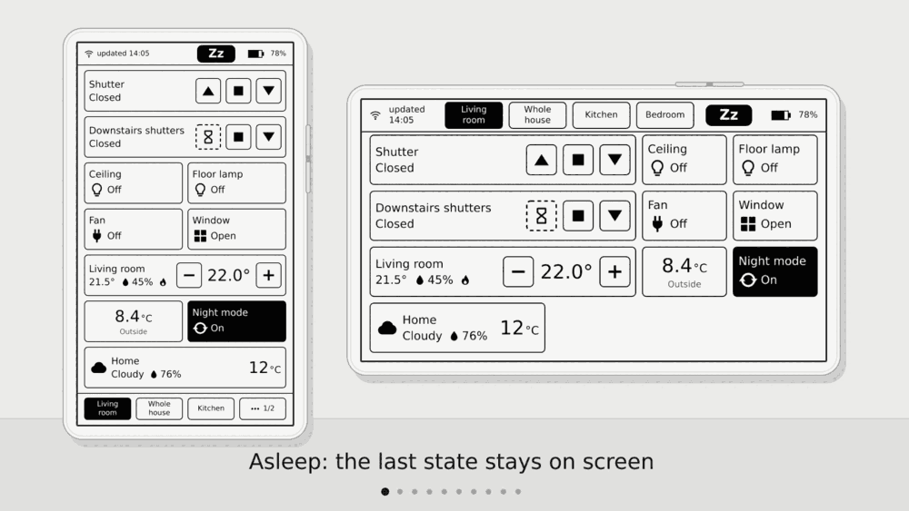

# Inkhaus

**Inkhaus** turns an **M5Stack M5Paper** e-ink touch screen into a battery-powered remote for
[Home Assistant](https://www.home-assistant.io/). It shows your shutters, lights, thermostats and
sensors, sends your taps to Home Assistant, and sleeps the rest of the time, so the screen always
shows the last known state without using power. Version 1.2.1, see [CHANGELOG.md](CHANGELOG.md).

Website: <https://asdwsda.github.io/inkhaus/>



*A tour of the screens (design mockups).*

## Get started in 4 steps

1. **Get the hardware.** The original **M5Stack M5Paper** (not the M5Paper S3), a USB-C **data**
   cable (some cables only charge), and a microSD card formatted **FAT32** (not exFAT).
2. **Download the Inkhaus Installer** for Windows, macOS or Linux from the
   [Releases page](https://github.com/asdwsda/inkhaus/releases/latest): Windows
   `inkhaus-installer-windows-x86_64.exe`, macOS `inkhaus-installer-macos-universal.zip`, Linux
   `inkhaus-installer-linux-x86_64.tar.gz`. The installer is unsigned, so your system warns on the
   first start; [docs/FLASHER.md](docs/FLASHER.md) shows how to open it anyway.
3. **Install.** Connect the M5Paper with the cable, start the installer and press **Install**.
   Details and fixes for common problems: [docs/FLASHER.md](docs/FLASHER.md).
4. **Add your two files.** Download the two example files below, rename them to `secrets.yaml` and
   `config.yaml`, edit them (see below) and either copy them
   to the **root of the SD card**, or press "Upload YAML files..." in the installer. The device
   restarts and shows your dashboard.

Without a `config.yaml` (or with Demo mode on) you see a demo dashboard with fake values, so you can
try the device before setting up Home Assistant.

## Your two files

Examples to copy: [`secrets.example.yaml`](secrets.example.yaml) and
[`config.example.yaml`](config.example.yaml). Use a plain text editor, and keep the spaces at the
start of lines exactly as shown (spaces, never tabs). Don't use Word: it changes quotes into curly
quotes. On Windows, turn on "File name extensions" in Explorer so the file is not saved as
`secrets.yaml.txt`.

**secrets.yaml** holds your Wi-Fi and Home Assistant access:

```yaml
wifi:
  - ssid: "MyWifi"
    password: "my-wifi-password"
home_assistant:
  internal_url: http://192.168.1.10:8123
  token: "paste-your-long-lived-token-here"
```

- `internal_url` is the address you use at home, normally `http://`, the IP address and port 8123.
  Home Assistant shows its IP address under **Settings, System, Network**. Optionally add
  `external_url: https://...` (Nabu Casa or your own HTTPS address, must start with `https://`) for
  use away from home.
- **Create the token** in Home Assistant: click your name at the bottom of the sidebar (your
  profile), open the **Security** tab, scroll to **Long-lived access tokens**, press **Create
  token**, name it "Inkhaus" and copy it right away (it is shown only once).
- Keep the token inside the quotes, on one line. It is stored as plain text on the card, so treat
  the card like a key.

**config.yaml** is your dashboard (it contains no secrets):

```yaml
version: 1
tabs:
  - title: Living room
    widgets:
      - entity: light.living_room_ceiling
      - entity: cover.living_room_shutter
        name: Shutter
      - entity: sensor.living_room_temperature
```

Find entity ids in Home Assistant under **Settings, Devices & services, Entities**. All options
(groups, sensor attributes, history graphs, landscape columns, several Wi-Fi networks, fixed IP):
[docs/CONFIG.md](docs/CONFIG.md).

## History graphs

Put a line or bar graph of any sensor straight on a tab with `display: graph`, or long-press a
sensor for its history popup:

```yaml
- entity: sensor.living_room_temperature
  display: graph
  history: 24
```

All options: [docs/CONFIG.md](docs/CONFIG.md).

## Using the device

- **Wake it** by pressing the rocker (the 3-way button on the side), or by touching the screen if
  you enabled a touch wake mode. A small **Zz** badge in the status bar shows it is asleep. The last screen is already there; fresh states arrive a moment later.
- **Tabs:** tap the tab bar, or move the rocker up / down. **Widgets:** tap them, or move the focus
  ring with the rocker and push to activate. In landscape, "up" points left.
- **Refresh now:** tap the "updated" label in the status bar.
- **Settings:** long push of the rocker, or tap the battery indicator. Four categories: Display,
  Sleep & wake, Network (Wi-Fi profile, Home Assistant connection) and Tools (demo mode, debug log).
  Changes are saved when you leave Settings (Back on the overview page, or after 60 s idle).
- The device goes back to sleep by itself after the idle timeout.

## Troubleshooting

- **I see the demo dashboard:** no `config.yaml` was found, or Demo mode is on (Settings, Tools).
  Check that the card is FAT32 and the file is in the root, not in a folder.
- **Offline in the status bar:** check the Wi-Fi name and password and the Home Assistant address in
  `secrets.yaml`. The device must be in range of your Wi-Fi (2.4 GHz). `external_url` must start
  with `https://`.
- **Token rejected:** create a new long-lived token and paste it into `secrets.yaml`. Make sure
  there is no extra space or line break inside the quotes.
- **A widget shows "-":** the state is unknown. **"n/a"** with a dotted frame means Home Assistant
  cannot reach that device. A widget that never leaves its loading look usually has a wrong entity
  id.
- **The Config row in Settings shows an error:** it names the place in `config.yaml` (for example
  `tabs[0].widgets[2].entity`, line 9), usually a missing space or a wrong indentation.
- **The screen looks garbled after installing:** the next start does one full redraw; if it stays,
  power-cycle the device.
- **Installer problems** (device not found, Windows/macOS warning): [docs/FLASHER.md](docs/FLASHER.md).

**Battery.** The default wake mode (rocker button) is the most economical; touch wake keeps the touch
controller awake and uses more battery, and Settings warns about it. Shorter idle timeouts and longer
refresh intervals save power. Battery life has not been measured yet.

## More

- All config options: [docs/CONFIG.md](docs/CONFIG.md)
- Installer: [docs/FLASHER.md](docs/FLASHER.md)
- Build from source, project layout: [docs/DEVELOPMENT.md](docs/DEVELOPMENT.md)
- Design decisions: [docs/ARCHITECTURE.md](docs/ARCHITECTURE.md)

## License

Copyright (C) 2026 Peter Szabo

Inkhaus is free software: you can redistribute it and/or modify it under the terms of the
GNU General Public License as published by the Free Software Foundation, either version 3 of
the License, or (at your option) any later version. It is distributed in the hope that it will
be useful, but WITHOUT ANY WARRANTY; see [LICENSE](LICENSE) for details.

Third-party parts keep their own licenses:
- `certs/gen_crt_bundle.py`: from ESP-IDF, Apache License 2.0 (GPL-3.0 compatible).
- `certs/cacert.pem` and the generated `certs/x509_crt_bundle`: Mozilla's CA root list, MPL 2.0.
- `tools/flasher/assets/DejaVuSans*.ttf`: DejaVu fonts (Bitstream Vera / public domain license),
  embedded in the installer.
- Libraries fetched at build time (not bundled): M5Unified and M5GFX (MIT), ArduinoJson (MIT),
  libyaml (MIT), Unity (MIT, tests only).
