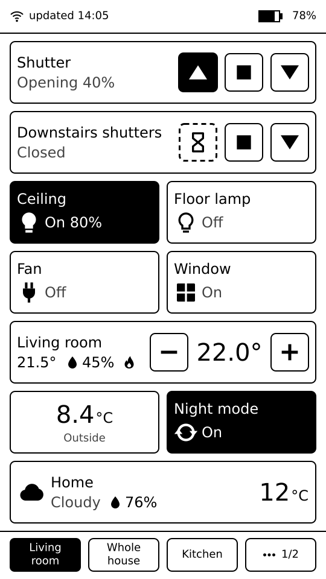
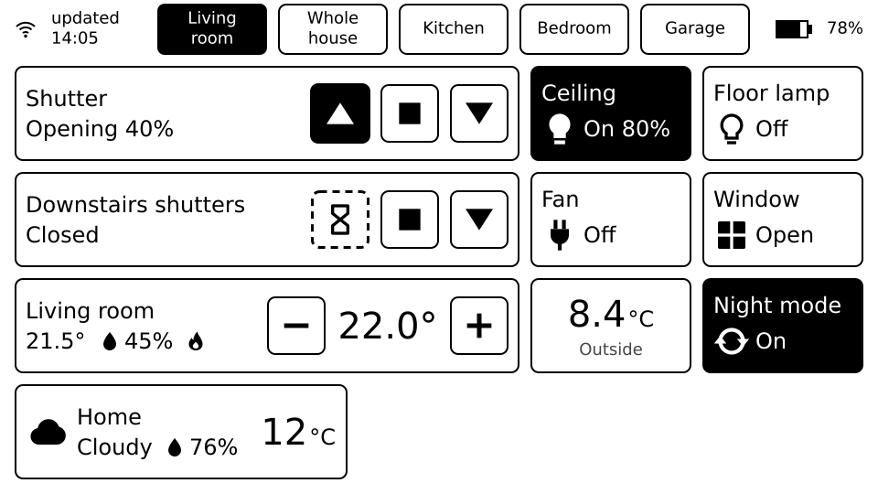
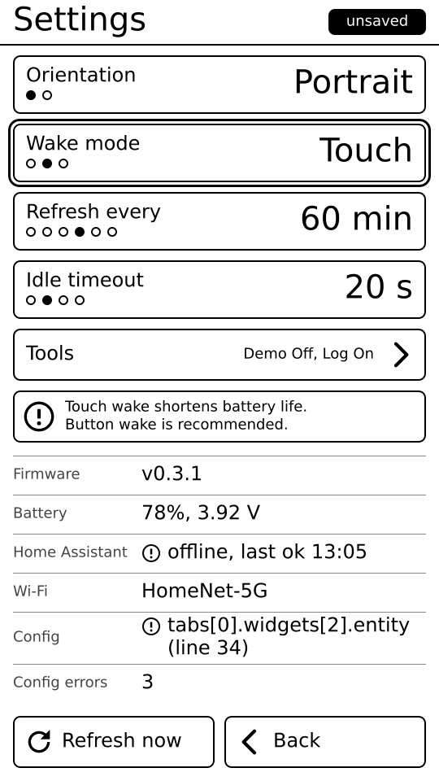
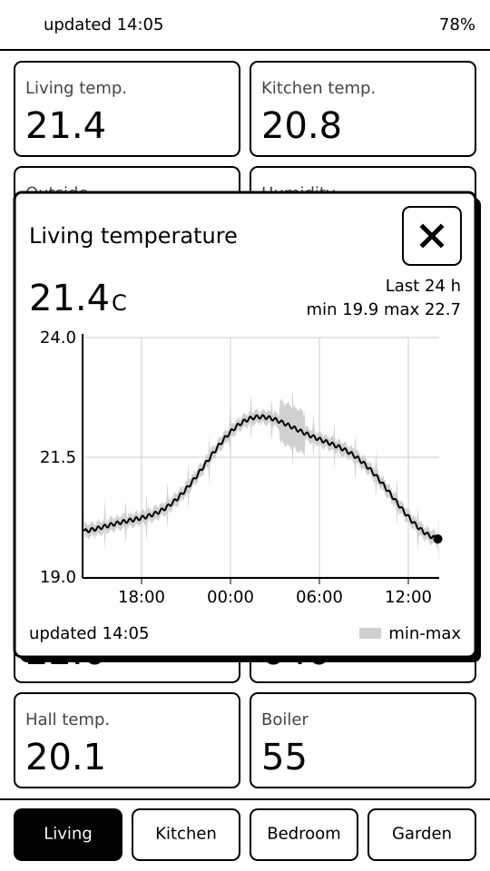
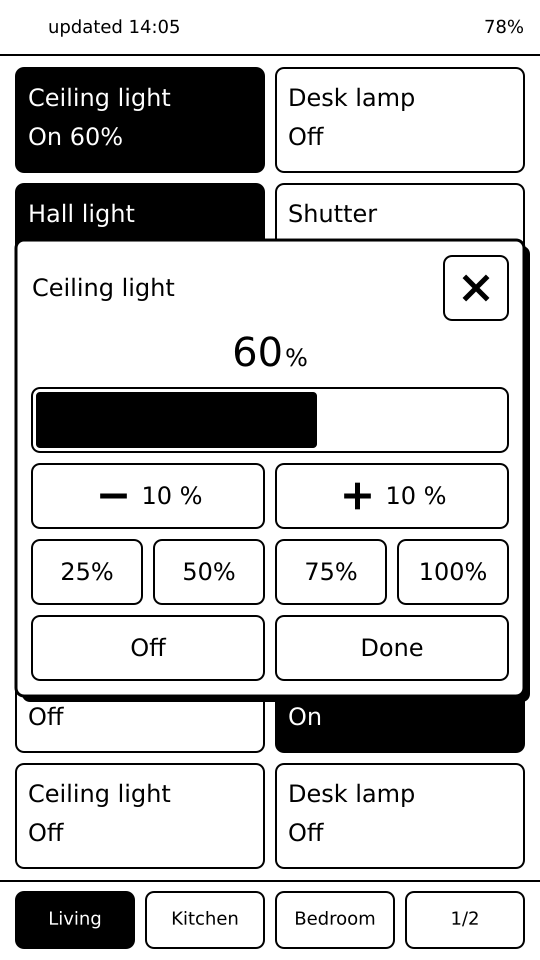

# Inkhaus

**Inkhaus** is a battery-powered e-ink remote control for [Home Assistant](https://www.home-assistant.io/),
running on the original **M5Stack M5Paper** (ESP32, 960×540 touch e-ink screen, 3-way rocker,
1150 mAh battery). It sleeps almost all the time, wakes on a button press, shows your shutters,
lights, thermostats and sensors from the last known state, and sends your taps to Home Assistant.

Version 1.1.0, see [CHANGELOG.md](CHANGELOG.md).

## Screenshots

| Portrait | Landscape |
|---|---|
|  |  |

*Design mockups of the two layouts.*

| Settings | History graph | Brightness |
|---|---|---|
|  |  |  |

*Settings, the history graph of a sensor, and the brightness control of a light (design mockups).*

## Features

- Tabs and widgets defined in a YAML file on the SD card; no reflashing to change the layout.
- Widgets: shutters (up / down / stop), lights, switches, automations, thermostats (target
  temperature), sensors (with attributes), binary sensors, weather, robot vacuums.
- Groups: control several entities at once (e.g. all shutters).
- Portrait and landscape; landscape with 4 or 5 columns per tab.
- Touch and rocker navigation with a focus ring.
- Fast taps: the widget changes immediately and reverts with a "failed" badge only on an error.
- Last known states are shown at once on wake; the status bar shows connecting / fetching /
  online / offline / outdated.
- Local-first connection with an optional external HTTPS URL (Nabu Casa, Cloudflare, ...).
- Scheduled refresh while asleep, three wake modes, configurable idle timeout.
- Built-in demo mode, debug log to the SD card, USB provisioning of config and secrets.

## How it works

- **Asleep almost all the time.** E-ink keeps its image with no power. The device wakes on the
  rocker (or a tap, depending on the wake mode), talks to Home Assistant, updates only the parts
  of the screen that changed, and goes back to deep sleep after the idle timeout. A small
  status-bar icon shows how to wake it.
- **Home Assistant REST API** with a long-lived access token. All states come from one
  `POST /api/template` call that returns compact JSON for just the configured entities.
  Actions are normal service calls.
- **Local first, remote fallback.** It tries `internal_url` first, then `external_url`, and
  remembers which one worked.

Design decisions and their reasons are in [docs/ARCHITECTURE.md](docs/ARCHITECTURE.md).

## Hardware

- M5Stack M5Paper, the original ESP32 version (not the M5Paper S3)
- a microSD card, FAT32 (not exFAT), for `config.yaml` and `secrets.yaml` (optional if you only
  provision over USB)
- a USB-C data cable for installing

## Install

The easiest way, no programming tools needed: download the **Inkhaus Installer** for Windows,
macOS or Linux from the [Releases page](https://github.com/asdwsda/inkhaus/releases/latest) (or
from the Inkhaus website), connect the M5Paper with a USB data cable and press **Install**. The
installer can also copy your `config.yaml` and `secrets.yaml` to the device. Step by step, with
troubleshooting: [docs/FLASHER.md](docs/FLASHER.md).

Then create your two files from the examples:
- `secrets.yaml` from [`secrets.example.yaml`](secrets.example.yaml): Wi-Fi, Home Assistant
  URL(s) and a long-lived token (Home Assistant, your profile, Security).
- `config.yaml` from [`config.example.yaml`](config.example.yaml): your tabs and widgets.

Put them on the **root of the SD card**, or upload them with the installer ("Upload YAML files...").

### Building from source (developers)

1. Install [PlatformIO](https://platformio.org/) (e.g. `pipx install platformio`).
2. Build and flash (M5Paper connected over USB):

   ```bash
   pio run                      # build
   pio test -e native           # unit tests on the PC
   pio run -e m5paper -t upload --upload-port /dev/ttyUSB0
   ```

   The first build downloads the ESP32 toolchain (a few hundred MB).
3. Alternatively send the files over USB with the helper script:

   ```bash
   python3 tools/provision.py --dry-run config.yaml          # size + CRC check, no device access
   python3 tools/provision.py config.yaml                    # sent as /config.yaml
   python3 tools/provision.py --name secrets.yaml secrets.yaml
   ```

   The tool never prints file content, only a summary such as `PUT-SECRETS ok wifi=yes ha=yes`.

Without a `config.yaml`, or with Demo mode on, Inkhaus shows the built-in demo dashboard
([`demo.yaml`](demo.yaml)) with fake values and no network.

For development you can put credentials in `include/secrets.h` (copy `include/secrets.example.h`);
it is only used when neither file provides a connection.

## Configuration reference

### secrets.yaml

```yaml
wifi:
  ssid: "MyWifi"
  password: "secret"
  static_ip:               # optional; if present, ip, gateway, subnet and dns are all required
    ip: 192.168.1.50
    gateway: 192.168.1.1
    subnet: 255.255.255.0
    dns: 192.168.1.1
home_assistant:
  internal_url: http://192.168.1.10:8123
  external_url: https://example.ui.nabu.casa   # optional, must be https
  token: "long-lived-token"
```

The token is stored as plain text on the SD card, so treat the card like a key. A `connection:`
section in `config.yaml` (old format) still works if there is no `secrets.yaml`; once
`secrets.yaml` exists it is an error.

### config.yaml

```yaml
version: 1
timezone: "CET-1CEST,M3.5.0,M10.5.0/3"     # optional
groups:
  downstairs_shutters: [cover.living_room_shutter, cover.kitchen_shutter]
tabs:
  - title: Living room
    landscape_columns: 4                   # optional: 4 or 5 (default 5)
    widgets:
      - entity: cover.living_room_shutter
        name: Shutter
      - group: downstairs_shutters
        name: Downstairs shutters          # required for groups
      - entity: light.living_room_ceiling
      - entity: sensor.living_room_climate
        name: Living room
        size: 2x1
        attribute: temperature
        details: [humidity, dew_point]
        decimals: 1
```

| Key | Meaning |
|---|---|
| `version` | schema version, `1` |
| `timezone` | POSIX TZ string for the clock and wake schedule; default Central Europe (`CET-1CEST,M3.5.0,M10.5.0/3`) |
| `groups` | optional map `name: [entity, ...]`; names use lowercase letters, digits and `_`; all members share one domain; up to 16 per group |
| `tabs` | 1 to 16 tabs, each with `title` and `widgets` (up to 24); a tab that overflows the screen splits into sub-pages |
| `landscape_columns` | per tab, `4` or `5` (default `5`). With 4 columns, wide widgets are 2 cells, so two covers or thermostats fit per row. Portrait always has 2 columns |
| `entity` / `group` | each widget has exactly one of them |
| `name` | label; default is the Home Assistant friendly name; required for groups |
| `size` | `WxH` within what the widget type allows (see below); rarely needed |
| `type` | override the widget type for a domain without a built-in one (e.g. `person.alice` with `type: sensor`) |
| `attribute` | sensor: show this attribute instead of the state (`a-z`, `0-9`, `_`, max 40 chars) |
| `details` | sensor: up to 2 more attributes on a details line (only shown at 2x1 and wider) |
| `unit` | sensor: unit override for the main value, max 8 characters |
| `decimals` | sensor: round numbers to 0 to 3 decimals (default: whole numbers as is, others 1 decimal) |
| `history` | graph options: `false` (off), a number of hours (`history: 48`), or a mapping with `hours` (1 to 720, default 24), `type` (`auto`, `line`, `bar`, `step`), `statistic` (`mean`, `min`, `max`, `sum`, `change`), `period` (`auto`, `hour`, `day`), `min` / `max` (fixed y axis, `min` < `max`), `source` (`auto`, `history`, `statistics`). All optional. `statistic` (default `mean`, `sum` for `device_class: energy`) and `period` only apply to `type: bar`, elsewhere they are ignored. Errors: `type: bar` with `source: history`, and `period: hour` bars over more than 128 hours |

Widget types come from the entity domain: `cover`, `light`, `switch`, `automation`, `climate`,
`sensor`, `binary_sensor`, `weather`, `vacuum`. Cover, climate and vacuum are wide; light, switch,
automation and binary_sensor are 1x1; sensor is 1x1 (up to 2x1); weather is 2x1 (down to 1x1).
Sizes outside the allowed range are clamped. Details are in [docs/ui/layout.md](docs/ui/layout.md).
Config errors are reported with path and line, e.g. `tabs[0].widgets[2].entity (line 34)`. The
file may be at most 64 KB.

## Using the device

- **Wake** with the rocker push (Button mode) or by touching the screen (Touch modes). The last
  screen is already there; fresh states arrive a moment later.
- **Tabs:** tap the tab bar, or move the rocker up / down. **Widgets:** tap them, or move the focus
  ring with the rocker and push to activate. In landscape the rocker's up points left.
- **Refresh now:** tap the "updated" label in the status bar.
- **Settings:** long push of the rocker, or tap the battery indicator. Orientation, wake mode,
  refresh interval (off / 15 / 30 / 60 / 120 / 240 min), idle timeout (10 / 20 / 30 / 60 s). Changes
  are saved when you leave the page (an `unsaved` chip shows until then).
- **Tools** (a row in Settings):
  - **Demo mode:** shows the built-in demo dashboard and starts no Wi-Fi session.
  - **Debug log:** when on, each wake appends a line to `/wakelog.csv` and messages to
    `/debug.log` on the SD card. Read them without removing the card:

    ```bash
    python3 tools/wakelog.py wakelog.csv                    # default file: wakelog.csv
    python3 tools/wakelog.py --file debug.log debug.log
    ```

    The SD card costs a little time and power per wake, so leave it off normally.

## Wake modes and battery

| Mode | Wakes on | Battery |
|---|---|---|
| Button (default) | rocker push, plus the timer for scheduled refreshes | best |
| Touch | touch | worse: the touch controller stays awake |
| Touch & Button | both | like Touch |

All modes use ESP32 deep sleep with the power hold kept on. The Settings page warns that touch
wake shortens battery life. A scheduled refresh wakes on a timer, fetches states, redraws only
what changed and sleeps again without starting touch. Shorter idle timeouts and longer refresh
intervals save power. The standby current and multi-week battery life are not measured yet; the
plan is in [docs/battery-test-plan.md](docs/battery-test-plan.md).

## Troubleshooting

- **Nothing happens on first start / demo is shown:** no `config.yaml` was found, or Demo mode is
  on (Settings, Tools). Check that the card is FAT32 and the file sits in the root.
- **Offline in the status bar:** check the Wi-Fi name and password and the URLs in `secrets.yaml`.
  `internal_url` is plain `http://`, `external_url` must be `https://`.
- **Token rejected:** create a new long-lived token and update `secrets.yaml`. Make sure there is no
  stray whitespace or line break inside the quotes.
- **HTTPS fails:** Inkhaus embeds the Mozilla root bundle, so Nabu Casa, Let's Encrypt and
  Cloudflare/Google-hosted domains work. A private CA is not trusted. The first HTTPS request of a
  wake takes about 4 s through Cloudflare.
- **A widget shows "-" or "unavailable":** `unknown` is a normal state and is shown as "-".
  `unavailable` means Home Assistant can't reach the device. Covers without position feedback show
  "-" instead of a percentage; taps still work (Opening / Closing / Stopped).
- **Config errors:** the Settings page shows the first error with its path and line.
- **Widget doesn't appear:** entities missing from Home Assistant appear as unavailable; check the id.
- **Garbled screen after flashing:** the next boot does one full redraw; if it persists, power-cycle.

## Repository layout

| Path | Contents |
|---|---|
| `src/`, `include/` | Device code (Arduino, M5Unified/M5GFX); `include/version.h` holds the firmware version |
| `lib/` | Pure C++17 logic with no Arduino dependencies, unit-tested on the PC: `config`, `settings`, `ha_client`, `model`, `power`, `ui`, `session`, ... |
| `test/` | Native unit tests (Unity) |
| `config.example.yaml`, `secrets.example.yaml`, `demo.yaml` | Example dashboard, example credentials, built-in demo |
| `certs/` | Root certificate bundle for HTTPS |
| `docs/ARCHITECTURE.md` | Architecture and decision log |
| `docs/tasks/` | One file per task, with acceptance criteria |
| `docs/ui/` | Style guide, layout and widget specs, SVG mockups; `png/` has the renders |
| `docs/battery-test-plan.md` | How to measure battery life |
| `tools/` | `provision.py`, `wakelog.py`, `serial_capture.py`, `screenshot.py`, `device_lock.sh`, mockup tooling |
| `probe/`, `epdtest/` | Diagnostic firmwares used to measure the hardware |

Mockups are reviewed as PNGs rendered with DejaVu Sans, the font the firmware uses.

## How it's developed

The project is built with [Claude Code](https://claude.com/claude-code) agents, defined in
`.claude/agents/`: an architect who plans, reviews and commits; a UI designer who writes the specs;
a firmware developer; and a tester. Each task goes through spec, implementation, independent
testing and review. See [CLAUDE.md](CLAUDE.md) and [docs/tasks/README.md](docs/tasks/README.md).

## License

Copyright (C) 2026 Peter Szabo

Inkhaus is free software: you can redistribute it and/or modify it under the terms of the
GNU General Public License as published by the Free Software Foundation, either version 3 of
the License, or (at your option) any later version. It is distributed in the hope that it will
be useful, but WITHOUT ANY WARRANTY; see [LICENSE](LICENSE) for details.

Third-party parts keep their own licenses:
- `certs/gen_crt_bundle.py`: from ESP-IDF, Apache License 2.0 (GPL-3.0 compatible).
- `certs/cacert.pem` and the generated `certs/x509_crt_bundle`: Mozilla's CA root list, MPL 2.0.
- Libraries fetched at build time (not bundled): M5Unified and M5GFX (MIT), ArduinoJson (MIT),
  libyaml (MIT), Unity (MIT, tests only).
