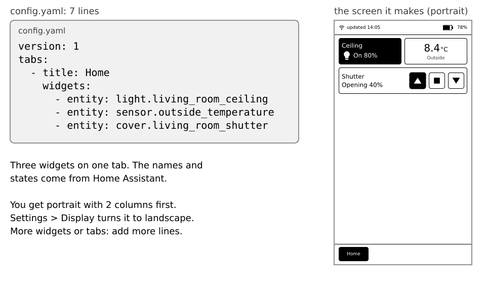

# Getting started

This page takes you from an unopened box to a working dashboard. It needs about 20 minutes and no programming. If a step goes wrong, each step has an "If it doesn't work" line, and page [Troubleshooting](10-troubleshooting.md) has more.

## What you need

- An **M5Stack M5Paper**, the original one (not the M5Paper S3).
- A USB-C cable that carries **data**. Some cables only charge: if your computer does not see the device, try another cable.
- A **microSD card** formatted as **FAT32** (not exFAT). Cards of 32 GB or less are the easiest to format as FAT32.
- A computer with **Chrome, Edge or Opera** for the installation.
- A running **Home Assistant** that the M5Paper's Wi-Fi network can reach. It must be a 2.4 GHz Wi-Fi network.

 and the ports.")

## The five steps

1. Install the software in your browser.
2. Create a Home Assistant token.
3. Write two small text files and put them on the SD card.
4. Put the card in the device and switch it on.
5. Check the first screen.

## Step 1: Install the software

1. Open the [install page](../../install/) in Chrome, Edge or Opera.
2. Plug the M5Paper into your computer with the USB-C cable.
3. Press **Install** and pick the serial port that appears (often called "CP2104" or "USB Serial").
4. Wait until the page says it is done. The device restarts by itself.

**What you'll see:** a progress bar on the page, then the Inkhaus logo on the device screen.

**If it doesn't work:** try another USB cable or port. Firefox and Safari cannot do this step: use the installer app from the [Releases page](https://github.com/asdwsda/inkhaus/releases/latest) instead. Your settings and the SD card are kept when you install again later.

## Step 2: Create a Home Assistant token

The device needs a password of its own to talk to Home Assistant. It is called a **long-lived access token**. Create it like this:

1. Open Home Assistant in your browser.
2. Click your **name at the bottom of the sidebar** to open your profile.
3. Open the **Security** tab.
4. Scroll down to **Long-lived access tokens** and press **Create token**.
5. Name it "Inkhaus" and press OK.
6. **Copy the token right away.** Home Assistant shows it only once. Paste it into a text file for now.

Home Assistant explains this too (the screens can differ between versions): [Home Assistant: authentication, long-lived access tokens](https://www.home-assistant.io/docs/authentication/#your-account-profile).

**If it doesn't work:** you can always make a new token and delete the old one, so there is no risk in trying again.

## Step 3: The two files

Inkhaus reads two plain text files from the **root** of the SD card (not inside a folder):

- `secrets.yaml` is **private**: your Wi-Fi password, the address of Home Assistant and the token. Never share it.
- `config.yaml` is your **dashboard**: which widgets on which tab. It holds no secrets, so you can share it when you ask for help.

Use a plain text editor (Notepad, TextEdit in plain-text mode, VS Code). Do not use Word: it turns quotes into curly quotes. Indent with **spaces, never tabs**. On Windows, switch on "File name extensions" in Explorer so your file is not saved as `secrets.yaml.txt`.

### secrets.yaml, minimal

```yaml
wifi:
  - ssid: "MyWifi"
    password: "my-wifi-password"
home_assistant:
  internal_url: http://192.168.1.10:8123
  token: "paste-your-long-lived-token-here"
```

- `ssid` and `password` are your Wi-Fi name and password.
- `internal_url` is the address you use at home: `http://`, the IP address of Home Assistant and `:8123`. Home Assistant shows its IP address under **Settings, System, Network**.
- `token` is the token from step 2, on one line, inside the quotes.

Away from home, add `external_url: https://...` (it must start with `https://`). More options such as several Wi-Fi networks and a fixed IP address are on [the config reference](09-config-reference.md#secrets-yaml).

### config.yaml, minimal

```yaml
version: 1
tabs:
  - title: Home
    widgets:
      - entity: light.living_room_ceiling
      - entity: sensor.outside_temperature
      - entity: cover.living_room_shutter
```



An **entity** is one thing in Home Assistant, such as a light. Find the ids under **Settings, Devices & services, Entities**: copy the "Entity ID" column (for example `light.living_room_ceiling`). Replace the three example ids above with yours.

**If it doesn't work:** the file must be called exactly `config.yaml`, and the spaces at the start of the lines matter. [Troubleshooting](10-troubleshooting.md) shows how to read the error.

## Step 4: First start

1. Switch the device off (it is off if you just installed), take out the SD card and copy both files to its root.
2. Put the card back (the slot is on the edge, see the picture above) and press the rocker to switch the device on.

**What you'll see:** the logo, then "connecting", then your first tab, usually within 10 to 20 seconds. The screen flashes black and white once or twice: that is the e-ink screen cleaning itself.

If you have no `config.yaml` yet (or Demo mode is on), you see a demo dashboard with fake values. It is a nice way to try the device before you set up Home Assistant.

## Step 5: What the first screen means

At the top is a small bar with the time of the last update, the Wi-Fi state and the battery. Below it are your widgets, and at the bottom (in portrait) or top (in landscape) your tabs. [The screen](02-the-screen.md) explains every part.

If the status bar says **Offline**, the device could not reach Home Assistant: check the Wi-Fi name, password, the address and the token, see [Troubleshooting](10-troubleshooting.md).

## Next

- Learn the screen and the buttons: [The screen](02-the-screen.md), [Touch and buttons](03-touch-and-buttons.md).
- Add more widgets: [Widgets](04-widgets.md).
