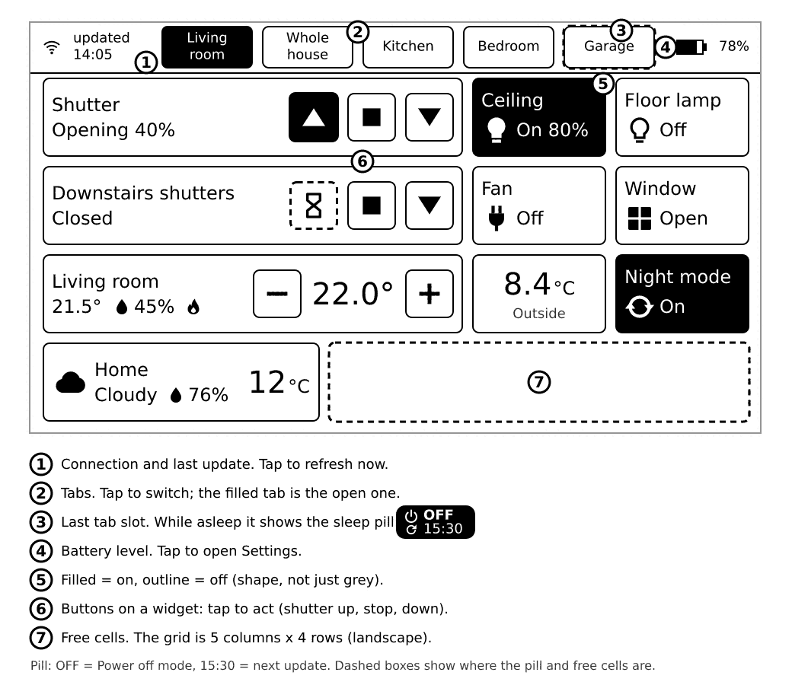
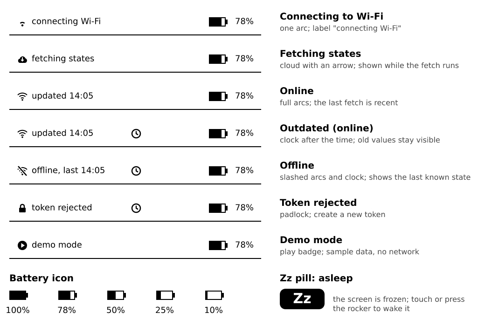
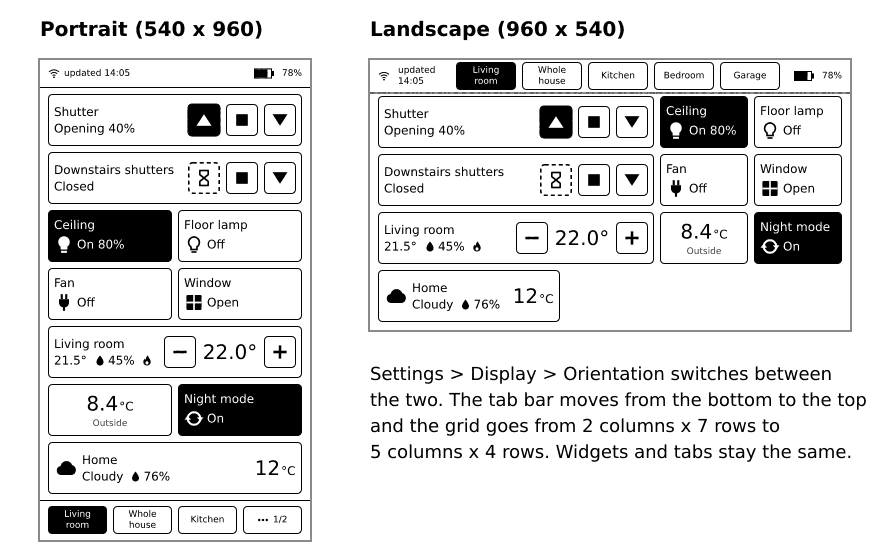
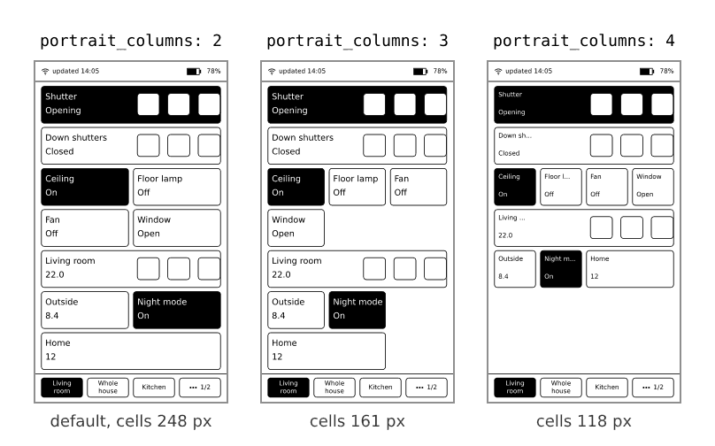

# The screen

## The dashboard

The dashboard is made of **tabs**. Each tab shows a grid of **widgets**: one square for each light, thermostat, sensor and so on.



- A widget that is **filled black** means "on" or "needs attention". An **outline** means "off" or "quiet".
- A **dashed frame** with an hourglass means your tap was sent and the device waits for Home Assistant to confirm.
- A **dotted frame** with `n/a` means Home Assistant says the thing is unavailable. Taps on it do nothing.
- A `-` means there is no value yet.

## What the little symbols mean



Tap the **"updated" label** (top left) to fetch fresh states at once. Tap the **battery** (top right) to open [Settings](06-settings.md).

## Portrait or landscape



Change this in Settings, Display, Orientation. The default is portrait. It takes effect when you leave Settings, with one full screen refresh.

In landscape, "up" on the rocker points to the left. The tab bar is at the bottom in portrait and at the top (right of the status bar) in landscape.

## Columns

The grid has more or fewer columns, depending on the orientation. You can choose per tab:

- `landscape_columns`: `4` or `5` (default `5`).
- `portrait_columns`: `2`, `3` or `4` (default `2`).

More columns means smaller widgets and more of them on one tab.



```yaml
tabs:
  - title: Living room
    portrait_columns: 3
    landscape_columns: 4
    widgets:
      - entity: light.living_room_ceiling
```

**What you'll see:** with 4 landscape columns the wide widgets (shutters, thermostats) are two cells wide, so two fit in a row. With 3 portrait columns wide widgets fill a whole row; with 4 columns only small widgets (sensor, binary sensor, switch, light, automation) can be one cell, and the icon sits above the text.

**If it doesn't work:** any other number is a config error and the Config row in Settings names it.

## A tab with too many widgets

If the widgets do not fit on the screen, the tab splits into pages and a small page switcher appears at the bottom. A tab holds up to 24 widgets. You can have up to 16 tabs. When the tab bar has no room for all tabs, its last slot becomes a "..." button that shows the next group of tabs.

## E-ink: a few things to expect

- The screen keeps its picture without power. When the device sleeps, the last picture stays.
- A tap shows its result with a quick black and white update. After a while, faint traces of earlier pictures (ghosting) can show. The device cleans them with a **full refresh**, when you change tab and before it sleeps. A flash now and then is normal.
- The screen is a bit slow, about half a second per update. Wait for it before you tap again.
