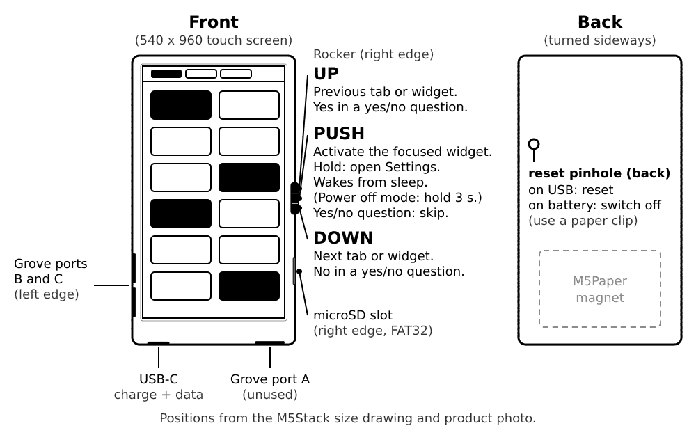

# Touch and buttons

You can use the device with your finger, with the rocker, or both.

## Touch

| Gesture | What it does |
|---|---|
| **Tap** a widget | Does its main action: switches a light, a switch or an automation, opens a popup for a media player or notifications. |
| **Tap a button inside a widget** | Shutter up / stop / down, thermostat minus / plus, vacuum start / pause / dock. |
| **Long press** a light (about half a second) | Opens the brightness popup. |
| **Long press** a sensor | Opens its history graph. |
| **Tap a tab** | Switches the tab. |
| **Tap "updated"** (status bar) | Fetches fresh states now. |
| **Tap the battery** (status bar) | Opens Settings. |
| **Tap the screen while it sleeps** | Wakes it, if Sleep mode is Touch or Touch & rocker. That first tap is not used as a click. |

Taps on a widget that shows a dotted frame (unavailable) are ignored.

## The rocker

The rocker is the 3-way button on the right edge of the device. You can push it **up**, push it **down**, or press it in (**push**). Hold the push for a longer press.

On a tab screen:

| Rocker | What it does |
|---|---|
| **Up / down** | Previous / next tab. In landscape, up points left. |
| **Push** | Starts the focus ring: a thick frame on the first widget. |
| **Up / down** (ring is on) | Moves the ring to the previous / next widget. After the last one it returns to the tabs. |
| **Push** (ring on a light, switch or automation) | Does the same as a tap. |
| **Push** (ring on a shutter, thermostat or vacuum) | Selects one of its buttons. Up / down moves between the buttons, push presses one. Long push leaves. |
| **Long push** (about half a second) | Opens Settings (from the tabs), or goes one step back (in the ring, a popup or in Settings). |
| **Hold push for 2.5 seconds** | Puts the device to sleep right away, from anywhere. |

The first rocker press after the device wakes both shows the ring and does its job, so you do not need to press twice.

## Yes or no questions

Some actions ask first, for example "Clear all" notifications or a firmware update. Answer with the rocker:

- **Up = yes**
- **Down = no**
- **Push = skip**

This is on purpose: a push can tilt the rocker by accident, so push never means "yes".

## Wake and sleep

- **Wake:** press the rocker. With Sleep mode Touch or Touch & rocker, a tap on the screen wakes it too. With Sleep mode **Power off**, hold the rocker push for about 3 seconds.
- **Sleep:** the device sleeps by itself after the idle timeout (20 seconds by default). To sleep at once, hold the rocker push for 2.5 seconds, or use Settings, Sleep now.

More on this in [Sleep and battery](07-sleep-and-battery.md).

## The reset button

On the back is a tiny reset hole next to the rocker side. Use a pin if the device does not react to anything. It restarts the device and keeps your files and settings.

**If it doesn't work:** if the screen stays blank, see [Troubleshooting](10-troubleshooting.md).
