# Widgets

A widget is one tile on a tab. You add it to `config.yaml` as one item of a tab's `widgets:` list. Most widgets need only the line `entity:` with the id from Home Assistant. The kind of widget follows from the first part of the id (`light.` gives a light).

Each section below says what the widget is for, what you can set, and shows a picture and a snippet to copy.

## Options every widget has

| Key | Values | Default | Effect |
|---|---|---|---|
| `entity` | an entity id, such as `light.floor_lamp` | none | The thing in Home Assistant. Every widget needs `entity` or `group`. |
| `group` | a group name from `groups:` | none | Several things in one widget (see [Cover groups](#cover-or-light-group)). |
| `name` | text | the Home Assistant name | The label on the tile. Required for groups. |
| `size` | `WxH`, such as `2x1` | depends on the type | Cells wide and high. Only some types allow another size (table at the end). |
| `type` | a widget type | from the entity | Pick the widget type yourself, for entities that have none (see [Show any entity as a sensor](#show-any-entity-as-a-sensor)). |

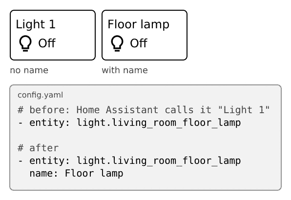

**What you'll see:** the tile shows your name instead of the Home Assistant name.

## Light

For lights. A tap switches it on or off. A **long press** opens a brightness popup, if the light can dim.

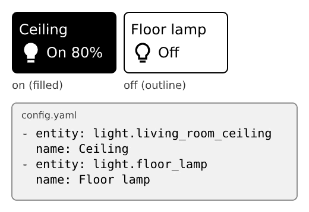

```yaml
- entity: light.living_room_ceiling
  name: Ceiling
```

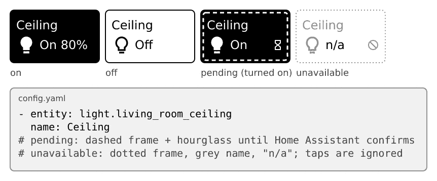

If the tile stays dashed with an hourglass, Home Assistant has not confirmed yet. If it is dotted with `n/a`, the light is unavailable.

The brightness popup has plus and minus buttons, presets and an Off button.

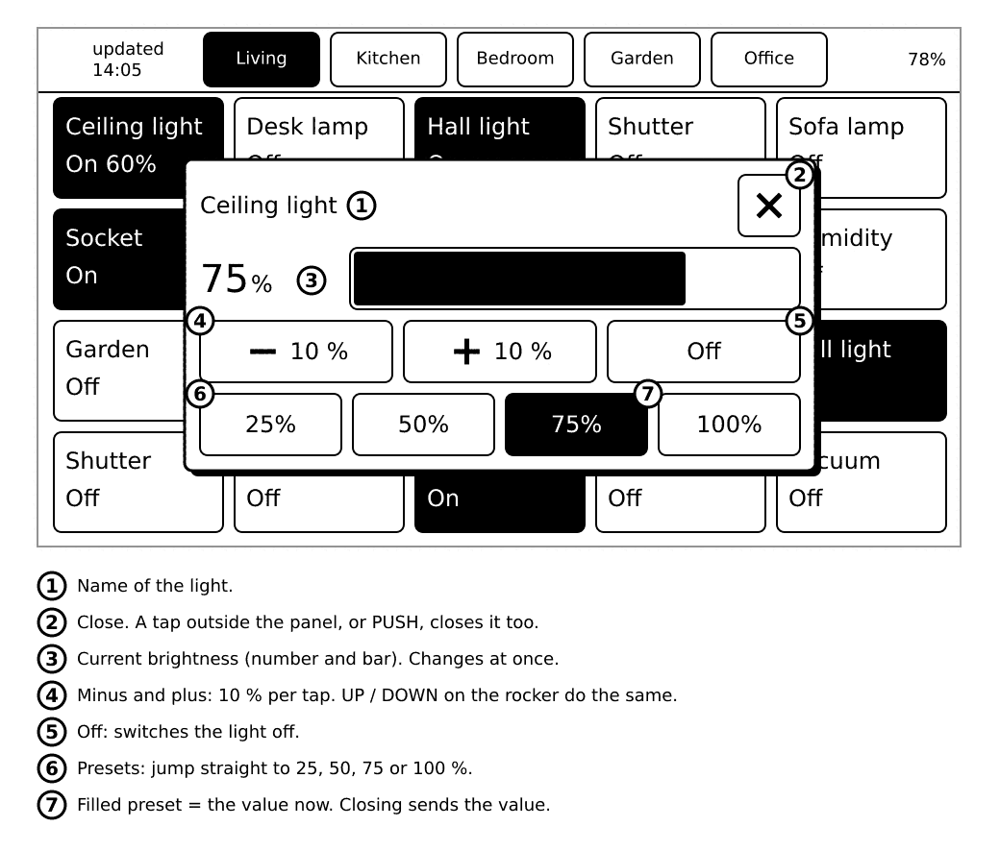

## Switch, window sensor and automation

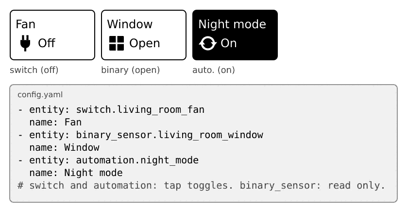

```yaml
- entity: switch.living_room_fan
  name: Fan
- entity: binary_sensor.living_room_window
  name: Window
- entity: automation.night_mode
  name: Night mode
```

- **Switch:** a tap toggles it.
- **Automation:** a tap enables or disables it. It does not run it.
- **Binary sensor** (door, window, motion): read only. Window and door say Open or Closed, other kinds say On or Off (motion says Motion or Clear).

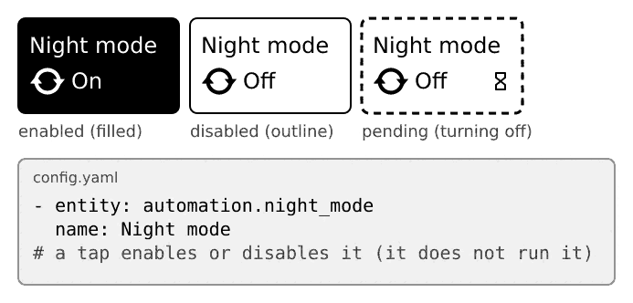

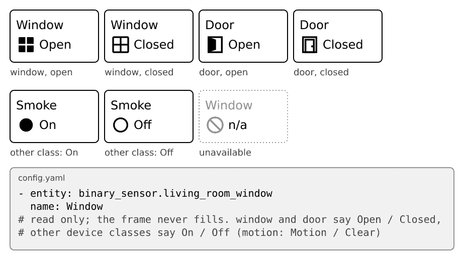

## Cover (shutter, blind)

A wide tile with three buttons: up, stop and down. The button of the direction the cover is moving in is filled.

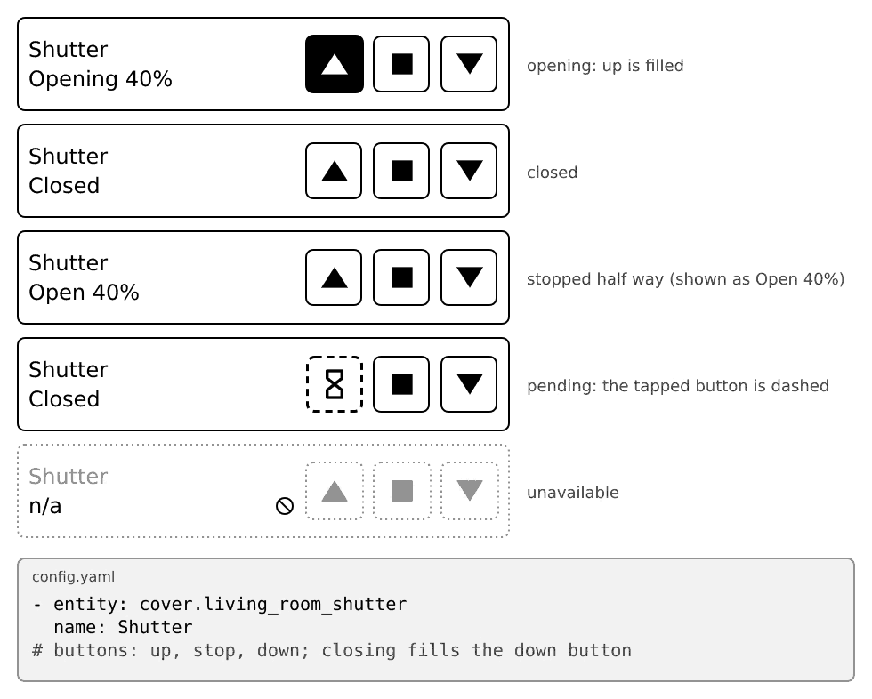

```yaml
- entity: cover.living_room_shutter
  name: Shutter
```

### Cover or light group

A **group** lets one tile control several things of the same kind. Define the group once at the top of the file, then use it as a widget:

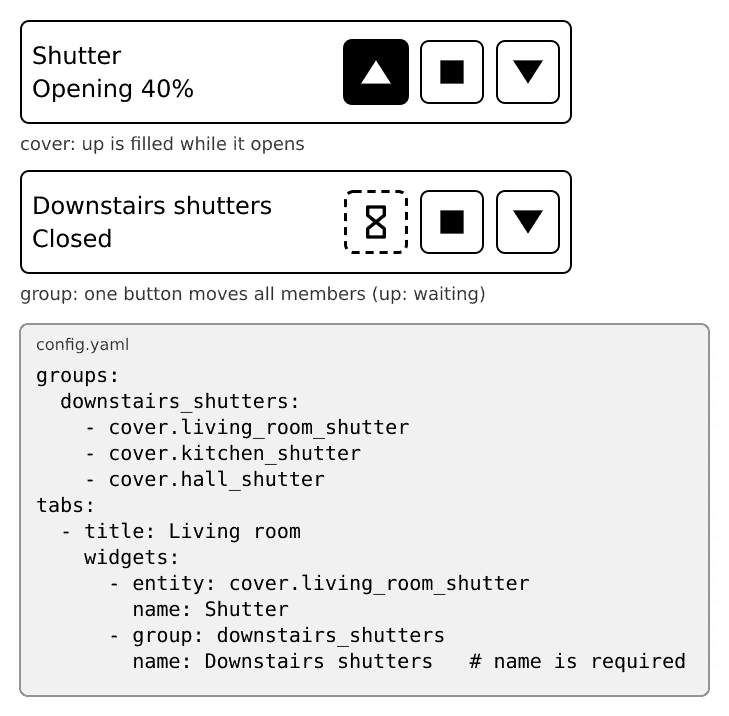

```yaml
groups:
  downstairs_shutters:
    - cover.living_room_shutter
    - cover.kitchen_shutter
    - cover.hall_shutter
tabs:
  - title: Living room
    widgets:
      - group: downstairs_shutters
        name: Downstairs shutters
```

- Group names use only lowercase letters, digits and `_`.
- All members share one kind (all covers, or all lights).
- A group has up to 16 members, and the widget **needs** a `name`.

**If it doesn't work:** "unknown group" means the name after `group:` is not spelled like the one under `groups:`.

## Thermostat (climate)

A wide tile: current temperature, humidity, a target and minus and plus buttons. Taps on the buttons are collected and sent 1.5 seconds after your last tap, so you can tap several times.

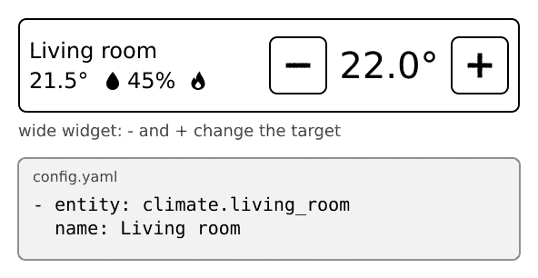

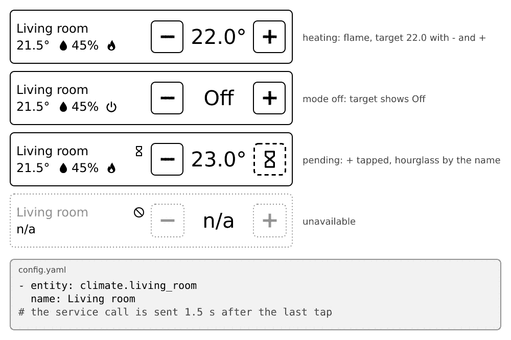

```yaml
- entity: climate.living_room
  name: Living room
```

## Sensor

Shows a value: a temperature, a humidity, a power reading. Read only. A **long press** shows its history graph.

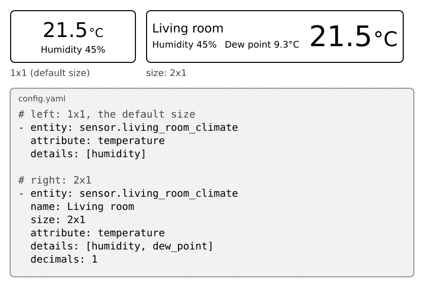

| Key | Values | Default | Effect |
|---|---|---|---|
| `attribute` | an attribute name (`a-z`, `0-9`, `_`, up to 40 characters) | the state | Show this attribute instead of the state. |
| `details` | up to 2 attribute names, in brackets | none | A second line, only visible at 2x1 or wider. |
| `unit` | text, up to 8 characters | from Home Assistant | Replaces the unit shown. |
| `decimals` | `0` to `3` | whole numbers as is, others 1 decimal | Rounds numbers. |
| `size` | `1x1` or `2x1` | `1x1` | `2x1` puts the name on the left and the value on the right. |

```yaml
- entity: sensor.living_room_climate
  name: Living room
  size: 2x1
  attribute: temperature
  details: [humidity, dew_point]
  decimals: 1
```

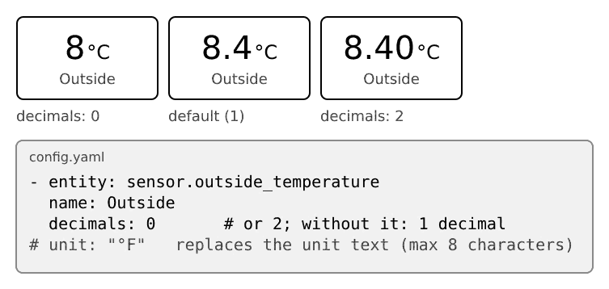

**If it doesn't work:** `n/a` with a dotted frame means Home Assistant says "unavailable"; `-` means no value yet. If the attribute is wrong, check its name in Home Assistant under **Developer tools, States**.

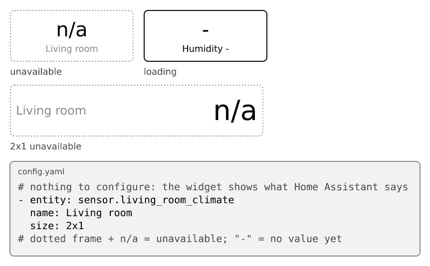

### Show any entity as a sensor

Some entities have no widget of their own, for example `person.alice`. Tell the device to show them as a sensor:

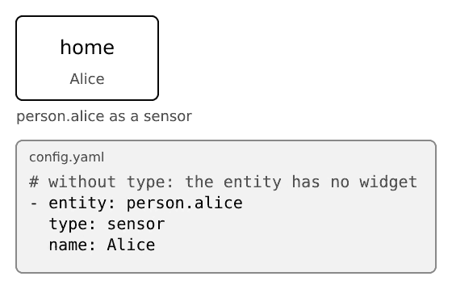

```yaml
- entity: person.alice
  type: sensor
  name: Alice
```

Without `type: sensor`, the Config row in Settings reports "unsupported entity domain".

## Weather

A tile with the current condition and temperature. Default size is 2x1; 1x1 is possible.

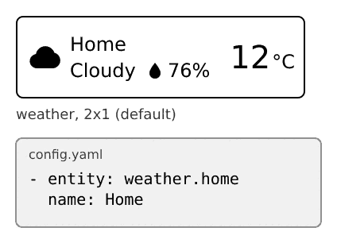

```yaml
- entity: weather.home
  name: Home
```

### Forecast

Add `forecast: true` for the next 3 days (weekday, icon, high and low). It needs a wide tile: the size is raised automatically. A day that Home Assistant does not answer shows `-`.

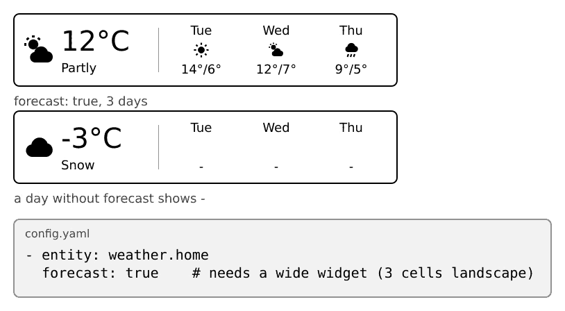

```yaml
- entity: weather.home
  forecast: true
```

The forecast is fetched for the tab you are looking at: at each scheduled wake, and when you wake the device only if the last answer is older than 30 minutes. `forecast` works for a single weather entity only, not for a group. Default `false`.

## Vacuum

A wide tile with start, pause and back to dock buttons.

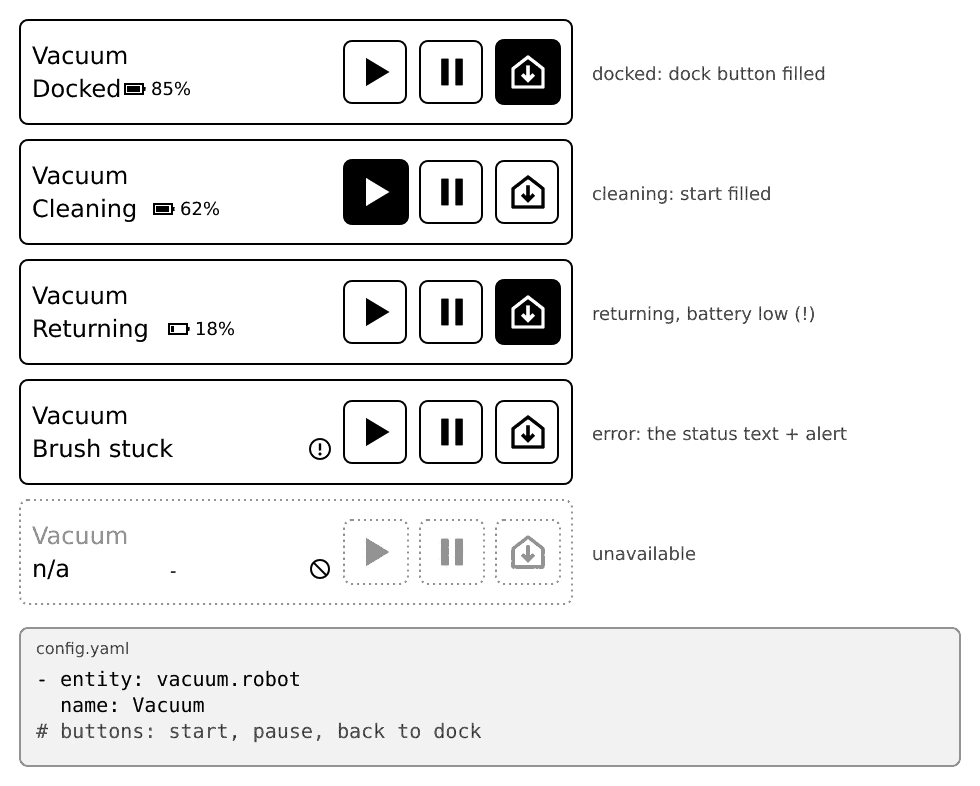

```yaml
- entity: vacuum.robot
  name: Vacuum
```

## Media player

A wide tile with the title and artist (your `name` while nothing plays) and previous, play or pause, and next buttons. **Tap the text** to open a popup with title, artist, album, the buttons, a volume bar (minus and plus in 5 % steps, or rocker up and down) and mute. Volume and mute are dotted when the player does not support them.

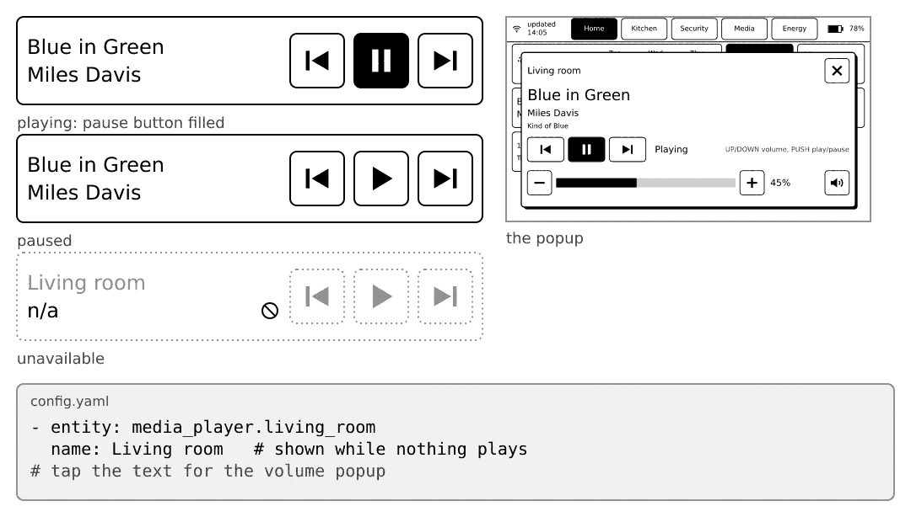

```yaml
- entity: media_player.living_room
  name: Living room
```

One entity per tile (no groups). With several players, give each a `name`.

## Notifications

A bell with the number of Home Assistant notifications. It has no `entity`. Tap it to open a list where you can dismiss one notification or press **Clear all** (which asks first).

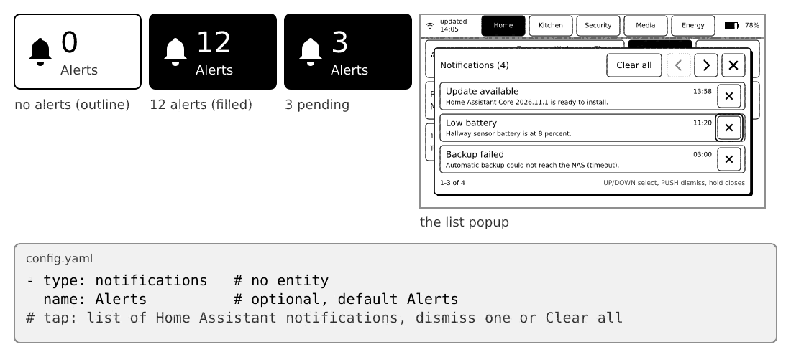

```yaml
- type: notifications
  name: Alerts
```

`name` is optional and defaults to `Alerts`. The tile is outline at 0 and filled when there is at least one. It shows `99+` above 99, `-` while loading and `n/a` when the list cannot be fetched.

## History graph on the tab

Add `display: graph` to a sensor to draw its history right on the tab. This works for sensors and binary sensors, one entity only.

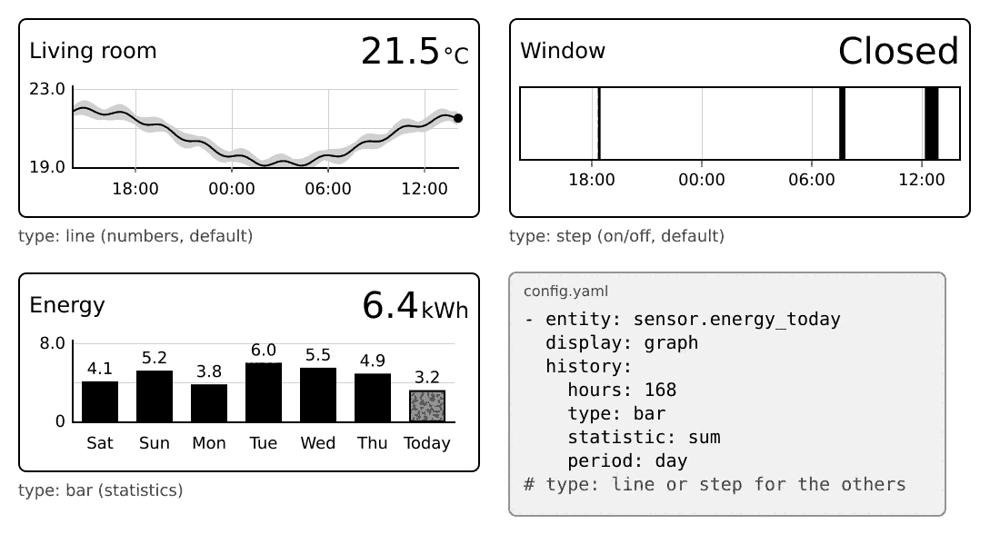

```yaml
- entity: sensor.living_room_temperature
  display: graph
  history: 24
```

- Default size is 2x2. It can be at least 2x1 and at most as wide as the grid by 3 rows.
- A graph is refreshed with every wake and when you open its tab. Taps and long presses on it do nothing.
- It cannot be combined with `attribute`, with a group, or with `history: false`.

### Graph options

`history` accepts a number of hours (`history: 48`), `false` to switch it off, or a block:

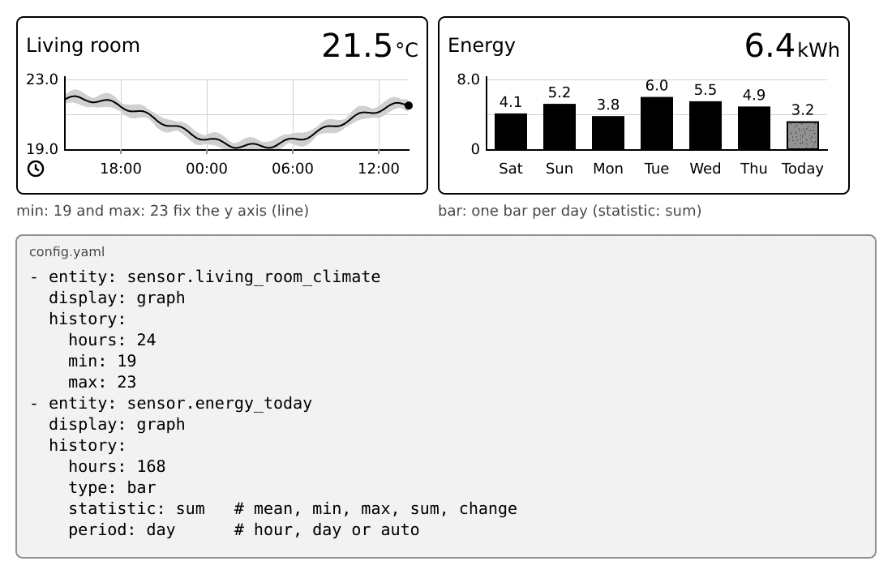

```yaml
- entity: sensor.energy_today
  display: graph
  history:
    hours: 168
    type: bar
    statistic: sum
    period: day
```

| Key | Values | Default | Effect |
|---|---|---|---|
| `hours` | 1 to 720 | 24 | How far back the graph goes. |
| `type` | `auto`, `line`, `bar`, `step` | `auto` | The shape. |
| `statistic` | `mean`, `min`, `max`, `sum`, `change` | `mean` (`sum` for energy sensors) | What a bar shows. Only for `type: bar`. |
| `period` | `auto`, `hour`, `day` | `auto` | The width of a bar. Only for `type: bar`. |
| `min`, `max` | numbers, `min` below `max` | automatic | Fixes the vertical axis. |
| `source` | `auto`, `history`, `statistics` | `auto` | Where the data comes from. Bars need `statistics` (the default picks it). |

Not allowed: `type: bar` with `source: history`, and hourly bars over more than 128 hours.

### The history popup

Without `display: graph`, a **long press** on a sensor still opens the history in a popup. Set `history: false` on the sensor to switch the popup off. The popup uses the same `history` options.

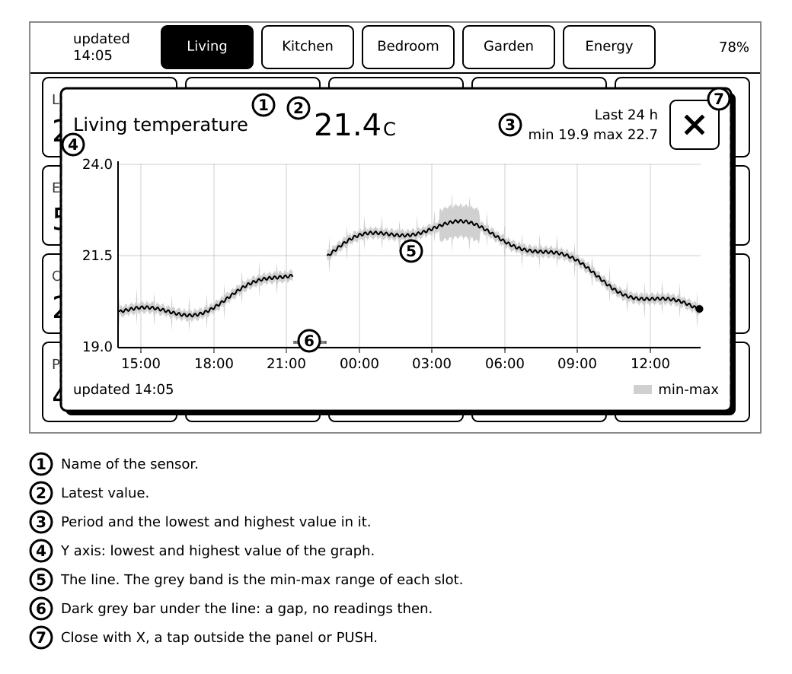

## Sizes

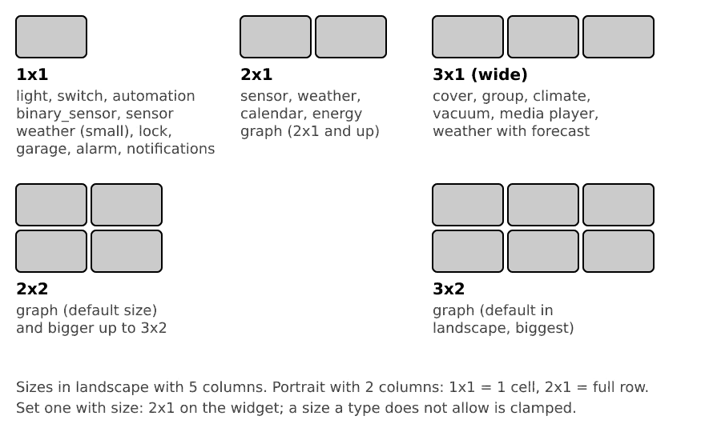

| Widget | Default | Other sizes |
|---|---|---|
| Light, switch, automation, binary sensor, notifications | 1x1 | none |
| Sensor | 1x1 | `2x1` |
| Weather | 2x1 | `1x1` (and wider with the forecast) |
| Cover, group, climate, vacuum, media player | wide (2 cells in portrait, 3 in landscape with 5 columns, 2 with 4 columns) | none |
| Graph | 2x2 | 2x1 up to a full-width, 3 row block |

A size a widget does not allow is changed to the nearest allowed one.

## Coming soon

These widgets are being built and do not work yet: a **calendar** (next event), an **alarm panel** and **locks and garage doors**, an **energy** widget, and **album art** in the media player. Do not use their entities yet: the device would report an unsupported entity.
