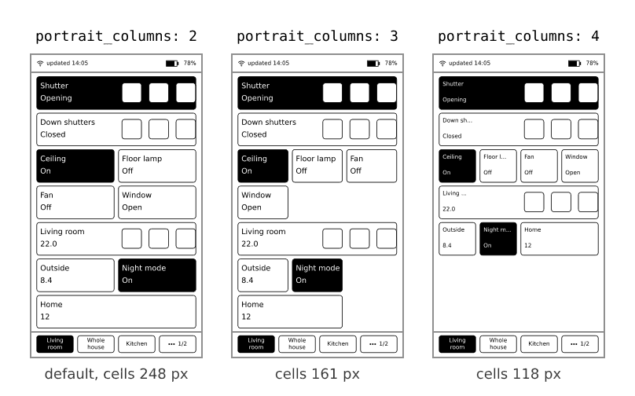

# Tabs and layout

`config.yaml` has a list of **tabs**. Each tab has a `title` and a list of `widgets`.

```yaml
version: 1
tabs:
  - title: Living room
    widgets:
      - entity: light.living_room_ceiling
      - entity: cover.living_room_shutter
  - title: Whole house
    widgets:
      - entity: climate.bedroom
      - entity: weather.home
```

## Limits

| What | Limit |
|---|---|
| Tabs | 1 to 16 |
| Widgets per tab | up to 24 |
| Groups | any number, up to 16 entities each |
| File size | up to 64 KB |

## Tab titles

Keep them short: long titles are cut off to fit the tab button. In portrait there are 4 tab slots, in landscape 5. With more tabs than slots, the last slot becomes a "..." button that moves on to the next group of tabs.

## Order and flow

Widgets fill the grid from left to right, then top to bottom, in the order of your list. A wide widget takes two or three cells and jumps to the next row if it does not fit. When a tab has more widgets than fit, it splits into **pages**: use the page switcher at the bottom, or the rocker (it moves on to the next page after the last widget).

## Columns per tab

Every tab can use its own grid:

```yaml
- title: Climate
  landscape_columns: 4
  portrait_columns: 3
  widgets:
    - entity: climate.living_room
    - entity: climate.bedroom
```

| Key | Values | Default |
|---|---|---|
| `landscape_columns` | `4` or `5` | `5` |
| `portrait_columns` | `2`, `3` or `4` | `2` |



Details are in [The screen](02-the-screen.md#columns). Which widget sizes exist: [Widgets, Sizes](04-widgets.md#sizes).

## Groups

A `groups:` entry at the top of the file lists entities of one kind (for example all shutters) under one name. A widget with `group:` then controls all of them with a single tap. See [Widgets, Cover or light group](04-widgets.md#cover-or-light-group).

## The clock and time zone

The device sets its own clock over the network when it connects. The default time zone is Central Europe. To change it, add a POSIX time zone string at the top of `config.yaml`:

```yaml
timezone: "CET-1CEST,M3.5.0,M10.5.0/3"
```

Examples: `GMT0BST,M3.5.0/1,M10.5.0` (London), `EST5EDT,M3.2.0,M11.1.0` (New York). The time zone is used for the clock, the "updated" time and the wake schedule.

**What you'll see:** the times in the status bar match your local time.

**If it doesn't work:** a wrong string gives odd times, not an error. Look up "POSIX TZ string" plus your city.

## Check your file

After you edit `config.yaml`, restart the device. Then open Settings, the **Config** row says `OK` or names the first mistake with its line. See [Settings](06-settings.md#reading-the-config-row).
