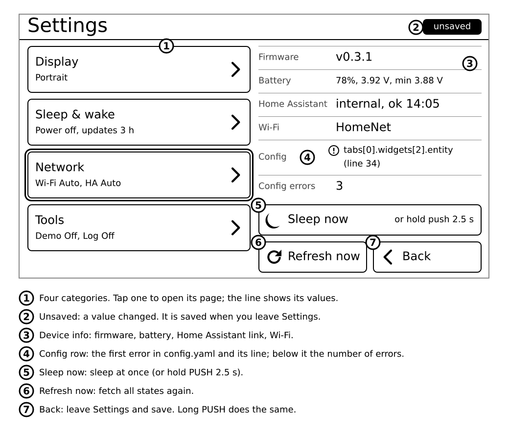
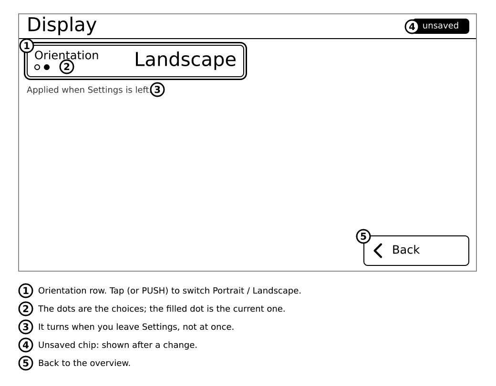
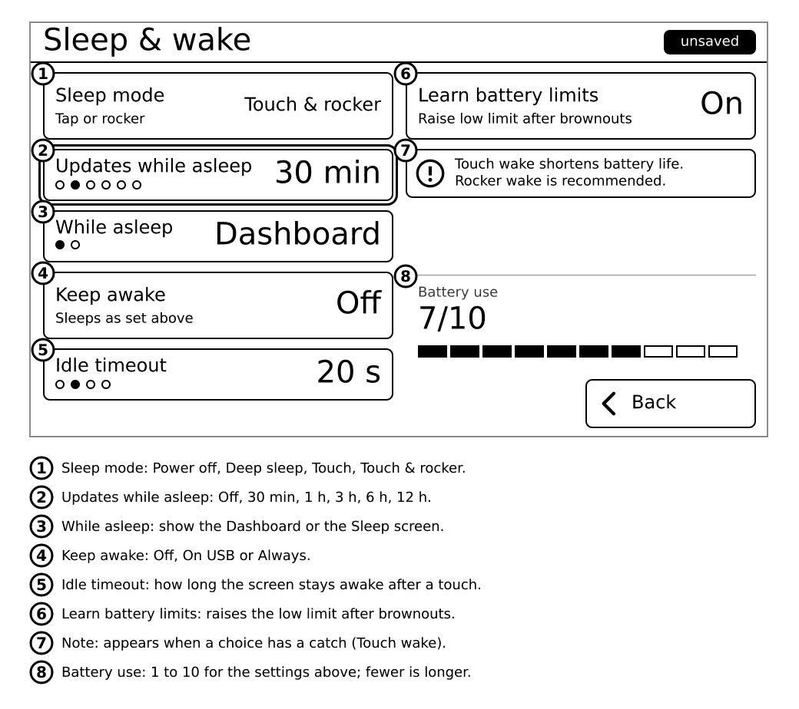
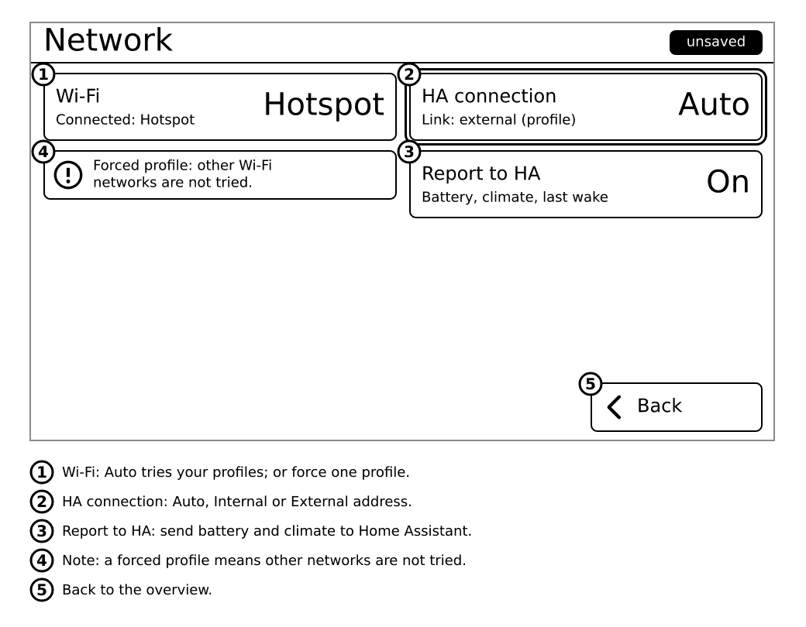
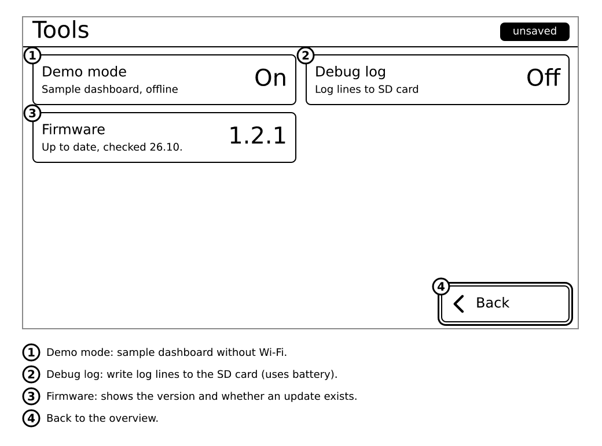

# Settings

Open Settings by **tapping the battery** in the status bar, or by **holding the rocker push for about half a second**. Settings is a menu with four categories.

- Tap a row (or move with the rocker and push) to **switch to its next value**. The value cycles in a fixed order and wraps around. There is no list to pick from.
- A small **unsaved** label appears at the top while you have changes.
- Changes are **saved when you leave** Settings (Back on the overview, a long push of the rocker, or 60 seconds without touching). Going between the overview and a category page saves nothing yet.

The overview also has **Refresh now** (fetches fresh states), **Sleep now**, and an info block: firmware version, battery, the Home Assistant link and last success, the Wi-Fi network, the config status and the number of config errors.

## Display

| Row | Values | Default | Effect |
|---|---|---|---|
| Orientation | Portrait, Landscape | Portrait | Turns the whole screen. Applied when you leave Settings, with one full refresh. |

## Sleep and wake

| Row | Values | Default | Effect |
|---|---|---|---|
| Sleep mode | Power off, Deep sleep, Touch, Touch & rocker | Deep sleep | How the device sleeps and what wakes it. See [Sleep and battery](07-sleep-and-battery.md). |
| Updates while asleep | Off, 30 min, 1 h, 3 h, 6 h, 12 h | 1 h | The device wakes by itself this often, fetches states, redraws and sleeps again. |
| While asleep | Dashboard, Sleep screen | Dashboard | What stays on the screen during sleep. See [Sleep screen](08-sleep-screen.md). |
| Keep awake | Off, On USB, Always | Off | On USB: never sleeps while plugged in. Always: never sleeps. |
| Idle timeout | 10 s, 20 s, 30 s, 60 s | 20 s | How long the device waits without a touch before it sleeps. Not used when Keep awake is Always. |
| Learn battery limits | Off, On | On | After a brownout (the battery ran out before the device expected) it raises its own low-battery limit so it sleeps earlier next time. |

Below the rows, **Battery use** shows a bar from 1 (lowest) to 10 (highest). It changes while you change the rows, so you see what each choice costs.

A note appears when you pick a touch mode ("Touch wake shortens battery life") or when Power off cannot wake itself ("updates stay Off").

## Network

| Row | Values | Default | Effect |
|---|---|---|---|
| Wi-Fi | Auto, or the name of a profile from `secrets.yaml` | Auto | Auto uses the first known network in range. A name forces that profile only. |
| HA connection | Auto, Internal, External | Auto | Which Home Assistant address to use. Auto learns per network which one works. |
| Report to HA | Off, On | On | On: the device reports its battery, the room temperature and humidity and its last wake to Home Assistant, so you can see them there. |

The hints under the rows show what is connected right now ("Connected: Home", "Link: internal").

## Tools

| Row | Values | Default | Effect |
|---|---|---|---|
| Demo mode | Off, On | Off | On: shows a built-in demo dashboard with fake values and does not use Wi-Fi. Handy to try the device. |
| Debug log | Off, On | Off | On: writes a log to the SD card (`/debug.log`, up to 1 MB). Uses more battery. Turn it on when someone asks you for the log. |
| Firmware | (shows the version) | | Tap to check for a newer version. See below. |
| About | (info only) | | The exact build: version, variant, code revision and date. |

### Updating the firmware

The device checks for a new version about once a week and never interrupts you. When **Update available** shows in the Firmware row:

1. Plug in USB, or have more than 50 % battery.
2. Tap the Firmware row, then **Check now**.
3. Answer the question with the rocker: **up = yes, down = no**.

**What you'll see:** a progress screen, then the device restarts with the new version. If the new version does not start, the old one is restored by itself.

**If it doesn't work:** "needs USB or 50% battery" means plug in USB. "Wi-Fi not connected" means check your Wi-Fi first. You can always install again from the [install page](../../install/).

## Reading the Config row

On the overview, the **Config** row says what the device made of `config.yaml`:

| Config row says | Meaning |
|---|---|
| `OK` | The file is fine. |
| `tabs[0].widgets[2].entity (line 34)` | The first mistake: tab 1, widget 3, its `entity`, on line 34 of the file. (The device counts from 0 in the brackets, so `[0]` is the first.) |
| `no config.yaml on SD` | The card is not read, or the file is in a folder, or is misnamed. |
| `built-in demo` | Demo mode is on. |

The **Config errors** row shows how many mistakes there are. Fix the first, restart, and look at the next.

Most mistakes are a missing space, a tab character instead of spaces, or a missing quote.

## Leaving Settings

Leaving always redraws the tab screen once (a full flash). After 60 seconds without touching, Settings closes by itself and the device goes to sleep.
