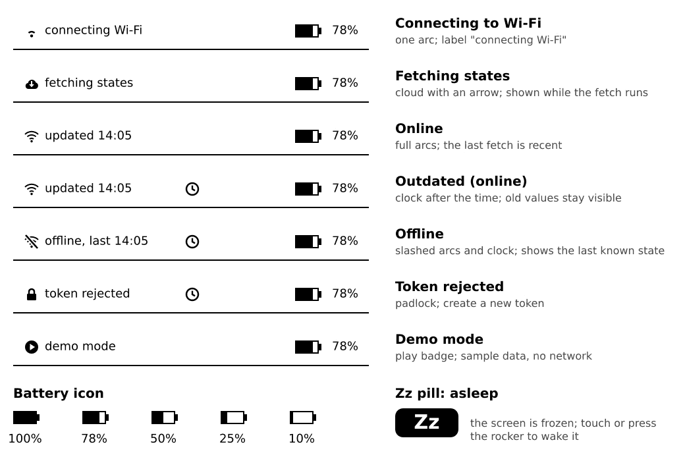

# Sleep and battery

E-ink keeps its picture without power, so the device sleeps most of the time. The screen always shows the last known state, and the battery lasts for weeks instead of hours.

## What happens when it wakes

Each time the device wakes (you pressed the rocker, touched the screen, or its timer went off), it does the same:

1. It shows the last screen at once.
2. It joins your Wi-Fi.
3. It asks Home Assistant for the current states.
4. It redraws what changed.
5. After the idle timeout without a touch, it goes back to sleep.

The device talks to Home Assistant over your Wi-Fi: the first Wi-Fi profile in range is used, and the internal or external address depending on where it is.

**What you'll see:** the last picture first, then fresh values a moment later. Before it sleeps, a small pill in the status bar shows the sleep mode and the time of the next scheduled update.

## Choose a sleep mode

Settings, Sleep and wake, **Sleep mode**:

| Mode | Wakes by | Wake time | Battery use |
|---|---|---|---|
| **Power off** | Hold the rocker push for about 3 seconds | about 1 s to a usable screen | lowest |
| **Deep sleep** (default) | Press the rocker | faster | low |
| **Touch** | Tap the screen | fast | high |
| **Touch & rocker** | Tap the screen or press the rocker | fast | highest |

The modes are listed from the lowest to the highest battery use. The **Battery use** bar at the bottom of the page shows the cost of your combination, from 1 to 10.

If you do not mind pressing a button, Deep sleep is a good balance. The touch modes keep the touch controller running, which costs battery.

## Updates while asleep

**Updates while asleep** (Off, 30 min, 1 h, 3 h, 6 h, 12 h; default 1 h) is how often the device wakes by itself to fetch states. Longer is cheaper. With Off it only updates when you wake it.

With **Power off**, the device wakes itself on schedule only if its clock chip can switch it on. If not, the row shows `Off` with a dotted frame and a note: updates stay off in that mode.

## Keep awake

**Keep awake** stops the idle sleep:

- **Off:** the device sleeps as set above.
- **On USB:** it stays awake while plugged in. Good for a desk or a charging dock.
- **Always:** it never sleeps. This drains the battery fast; the Battery use bar goes to 10.

## Sleep right away

Hold the rocker push for 2.5 seconds, or use **Sleep now** in Settings.

## The battery

The battery symbol in the status bar shows the level; a bolt means it is charging. Below 15 % the symbol shows `!`.

- The device **learns** the voltage at which the battery really runs out, and it sleeps cleanly before that. You can switch this off with Settings, Sleep and wake, Learn battery limits.
- Charge with a USB-C **data** cable on any USB port or charger.
- Shorter idle timeouts and longer update intervals save the most power.

## Report to Home Assistant

Settings, Network, **Report to HA** (On by default) sends the battery level, the room temperature and humidity measured by the device, and the time of its last wake to Home Assistant. Use it to see in Home Assistant when the battery is low. Set it to Off to send nothing.

**If it doesn't wake:** in Power off mode hold the push for 3 seconds. If it still does nothing, press the reset pinhole on the back and charge it via USB. See [Troubleshooting](10-troubleshooting.md).
