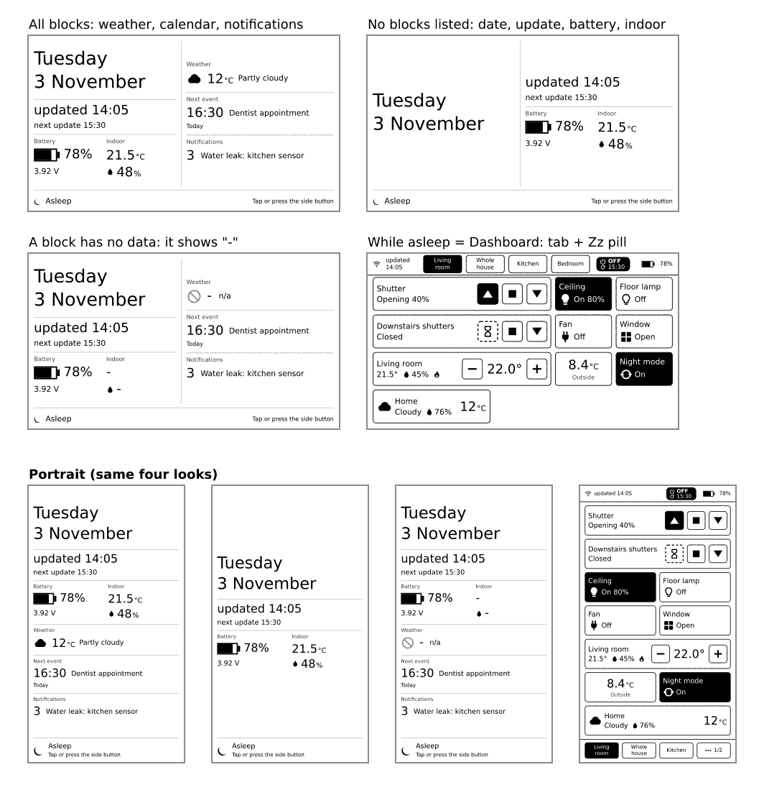

# Sleep screen

By default, the screen you were looking at stays on the display while the device sleeps. If you prefer something calmer, switch **While asleep** to **Sleep screen** (Settings, Sleep and wake). The last picture before sleep is then a quiet information page instead of your dashboard:

- the date and when the last update was,
- the next planned update,
- the battery level,
- the room temperature and humidity (from the device's own sensor),
- and optional blocks from Home Assistant that you choose.



The screen has **no live clock**: e-ink does not change during sleep, so a clock would be wrong. Instead, it says when it was last updated. At the bottom it says how to wake the device, for example "Press the rocker", depending on your Sleep mode.

## Optional blocks

Add a `sleep_screen:` section to `config.yaml`. Each line adds one block. Without the section, you get the screen with the core blocks only. It looks complete either way.

```yaml
sleep_screen:
  weather: weather.home
  calendar: calendar.family
  notifications: true
```

| Key | Values | What it adds |
|---|---|---|
| `weather` | a `weather.` entity | The weather now: icon, temperature and condition. |
| `calendar` | a `calendar.` entity | Your next event: its time and title, and whether it is today or tomorrow. |
| `notifications` | `true` or `false` | The number and the newest title of the Home Assistant notifications. Hidden when there are none. |

Any other key is reported as an error. The weather and calendar entities are fetched together with the dashboard states, so they cost no extra request. Notifications need one short extra call at each wake.

**What you'll see:** the screen shows only the blocks you listed. If the weather is not available, it says `n/a` in that block instead of an old value.

**If it doesn't work:** the entity must start with `weather.` or `calendar.` respectively, otherwise the Config row names the mistake. If the room temperature shows `-`, the device's own sensor did not give a reading.

## Wake from the sleep screen

Touch or press the rocker as your Sleep mode says. The dashboard tab you were on comes back with fresh values. The tap that wakes the device is not used as a click.
