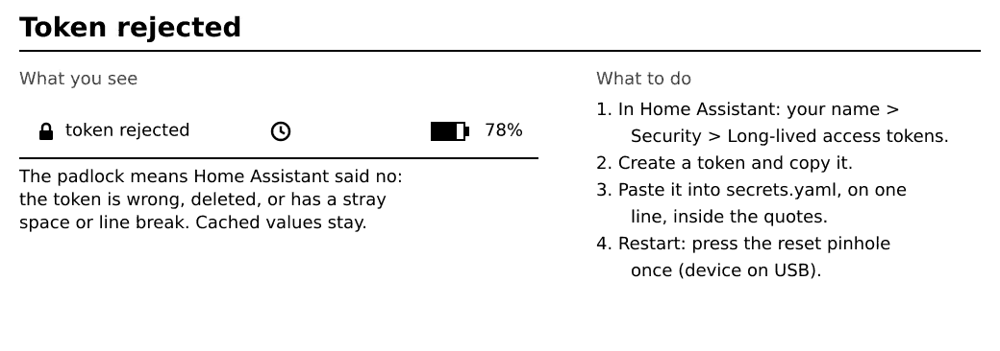
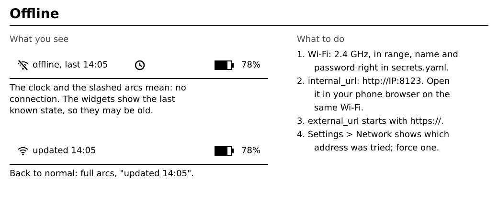
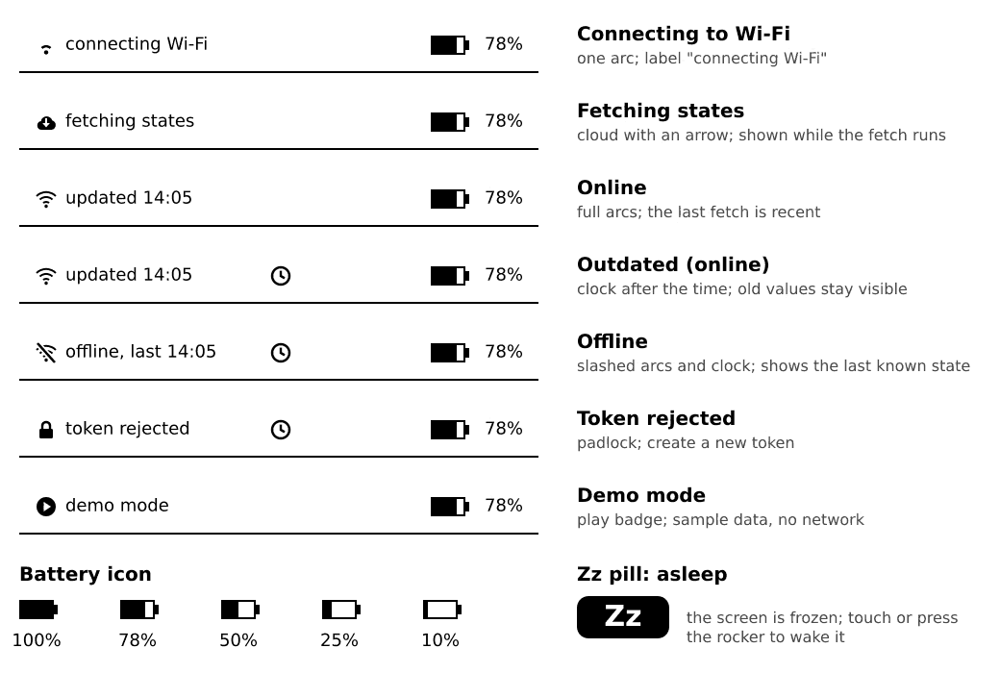
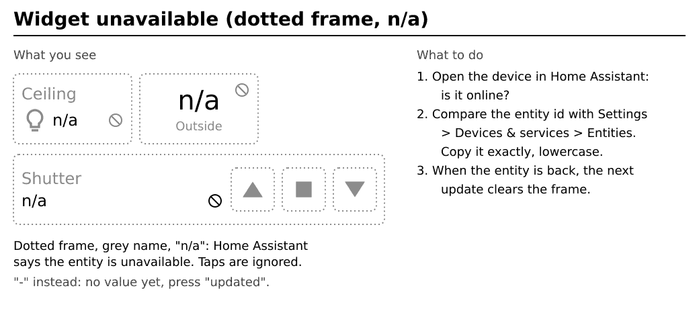
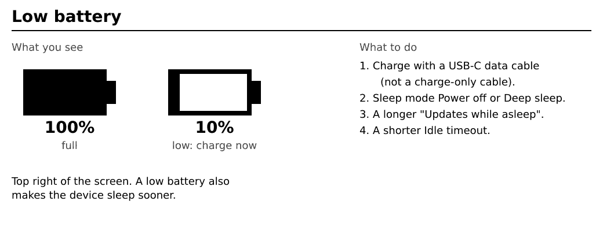

# Troubleshooting

Find what you see, then follow the fix. "Restart the device" below means: plug in the USB cable and press the pinhole on the back once (see [Touch and buttons](03-touch-and-buttons.md#the-reset-hole-pinhole)). Most problems are a typo in one of the two files or a Wi-Fi detail.

## It shows a demo dashboard with fake values

**Cause:** no `config.yaml` was found, Demo mode is on, or `secrets.yaml` is missing or incomplete (then you see your own layout with fake values).

**Fix:**
1. Settings, Tools: set **Demo mode** to Off.
2. Check that the SD card is formatted **FAT32** (not exFAT; cards over 32 GB need a special tool, see [Getting started](01-getting-started.md#what-you-need)) and that `config.yaml` is in the **root** of the card, not in a folder.
3. Check the file name: on Windows it may be `config.yaml.txt` if file extensions are hidden.

## Token rejected (padlock in the status bar)

**Cause:** the token is wrong, was deleted in Home Assistant, or has an extra space or line break.

**Fix:** create a new token ([Getting started, Step 2](01-getting-started.md#step-2-create-a-home-assistant-token)) and paste it into `secrets.yaml` on one line, inside the quotes.

## The status bar says Offline

**Cause:** the device cannot join Wi-Fi or cannot reach Home Assistant. The screen shows the last known state.

**Fix:**
1. The Wi-Fi must be **2.4 GHz** and in range. Check `ssid` and `password` in `secrets.yaml` (inside quotes, no extra space).
2. Check `internal_url`: `http://`, the IP address and `:8123`. Open the same address in a browser on your phone while on the same Wi-Fi.
3. `external_url` must start with `https://` and have a certificate from a normal authority: a self-signed certificate is refused. `internal_url` may be `http://` or `https://`.
4. Use the IP address in `internal_url`: `.local` names (mDNS) are often not found. Home Assistant on another network (VLAN, guest Wi-Fi) must be reachable from the Wi-Fi the M5Paper uses.
5. 5 GHz-only networks and hidden SSIDs do not work.
6. Open Settings, Network: the hints show which network and which address were used. Force a profile or address if needed.

## A widget shows `-` or `n/a`

- **`-`:** no value yet. Press "updated" to refresh. If it stays, the entity id is probably wrong: copy it again in Home Assistant under Settings, Devices & services, Entities.
- **`n/a` with a dotted frame:** Home Assistant says the entity is unavailable. Check the device in Home Assistant. Taps on it are ignored until it is back.

## The Config row in Settings shows an error

**Cause:** a mistake in `config.yaml`. The row names the place, for example `tabs[0].widgets[2].entity (line 34)`.

**Fix:** open `config.yaml`, go to that line and check:
- the spaces at the start of the lines line up with their neighbours (spaces only, no tabs),
- the colon is followed by a space (`entity: light.x`),
- quotes come in pairs and are straight quotes (not curly),
- the entity id is spelled like in Home Assistant.

Fix the first error, restart the device, and check again. The row [is explained here](06-settings.md#reading-the-config-row).

## "unsupported entity domain, set 'type' explicitly"

The entity is of a kind that has no widget (for example `person.`). Add `type: sensor` to show it as a sensor. For other kinds without a widget (a `scene`, say) this shows the state as text only: you can read it but not operate it. Locks, alarm panels and garage doors have their own widgets. See [Widgets, Show any entity as a sensor](04-widgets.md#show-any-entity-as-a-sensor).

## The screen stays blank or does not wake

1. Press the rocker. In **Power off** mode **hold it for about 3 seconds**.
2. Charge the device with the USB-C cable for a few minutes.
3. Plug in the USB cable and press the pinhole on the back once with a pin (restart).
4. Still nothing? Install again from the [install page](../../install/).

## The screen looks garbled after installing

The next start does one full redraw. If it stays garbled, restart the device.

## Faint traces of old pictures

That is normal for e-ink. The device cleans it with a full refresh when you change tab or before it sleeps.

## Taps seem slow

The screen needs about half a second per update. Wait for it, then tap again. A wake from sleep also needs a moment to join Wi-Fi.

## Low battery

Charge with a USB-C **data** cable. To make the battery last, use Sleep mode **Power off** or **Deep sleep**, a longer **Updates while asleep**, and a shorter **Idle timeout**. See [Sleep and battery](07-sleep-and-battery.md).

## An update failed or says rolled back

The previous firmware was restored. Try the update again on USB power, or install from the [install page](../../install/).

## The installer does not see the device

Use Chrome, Edge or Opera, a USB cable that carries data, and close other programs that use the serial port. Firefox and Safari cannot install from the web: use the installer app (a program you download and run on your computer) from the [Releases page](https://github.com/asdwsda/inkhaus/releases/latest).
